# FleetSentinel — 데이터 구조와 해석 가이드

한 주행 장면에 포함된 카메라·점군·차량 신호·객체 주석의 구조와 연결 관계를 설명한다.

- **데이터 구성:** [재생 화면](#1-재생-화면으로-보는-세-가지-데이터) → [nuScenes 스키마](#2-nuscenes-구조) → [데이터셋 규모](#3-원천-데이터)
- **데이터 처리:** [필드 계약](#5-필드-계약) · [시간 계약](#6-시간-계약) · [좌표 계약](#7-좌표-계약)
- **발생량과 검증:** [채널별 발생량](#4-채널별-발생량) · [검증 결과](#10-검증)

---

## 1. 재생 화면으로 보는 세 가지 데이터

### 1.1 카메라·점군·차량 신호 재생

**Rerun**으로 약 20초 길이의 `scene-0061`을 재생한 화면이다.

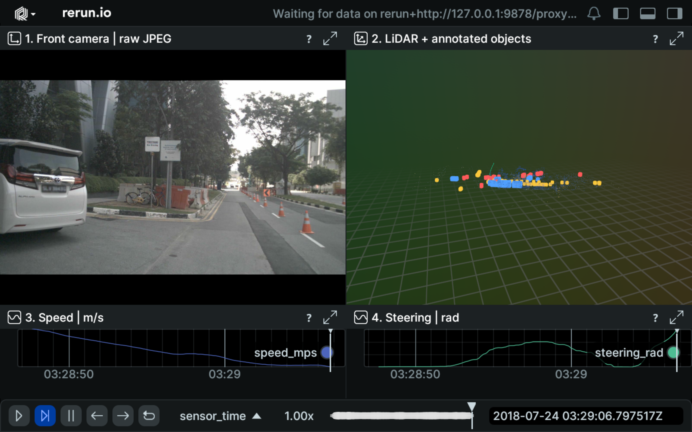

*scene-0061 재생 화면. 위쪽은 전방 카메라와 3D 공간, 아래쪽은 속도·조향 그래프다.
원천: nuScenes / Motional.*

- **카메라:** `CAM_FRONT`의 JPEG 이미지로 도로 상황을 확인한다.
- **점군:** LiDAR가 측정한 반사 위치를 3D 점으로 표시한다.
- **객체 박스:** nuScenes의 3D 객체 주석으로 위치·크기·방향을 표시한다.
- **신호 그래프:** ego_pose 시각에 가장 가까운 CAN 값을 연결해 속도·조향 변화를 표시한다.

타임라인을 이동하며 같은 구간의 영상·점군·신호를 확인한다.
재생본 생성과 실행은 [탐색 도구 안내](../exploration/README.md#실행)를 따른다.

### 1.2 데이터 분류와 레코드 단위

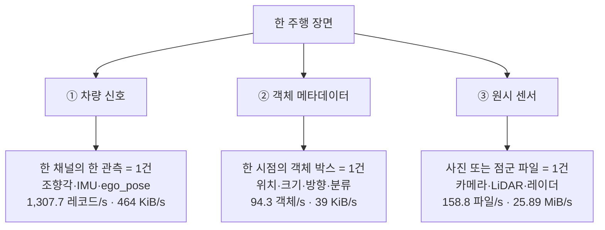

위 수치는 원천 발생량이다. 클라우드 전송량은 채널 선택·보고 간격·사건 구간에 따라 정한다.
채널별 측정값은 §4, 전송 정책은 [SDD](sdd.md)를 따른다.

---

## 2. nuScenes 구조

### 2.1 데이터베이스 스키마

nuScenes는 JSON 테이블의 `token`으로 행을 식별하고, `*_token`으로 다른 테이블을 참조한다.
구조를 **주행·센서 데이터**와 **객체 주석**으로 나누어 표시했다.
각 상자에는 조회에 필요한 주요 필드를 적었다.

#### 주행 구간과 센서 파일

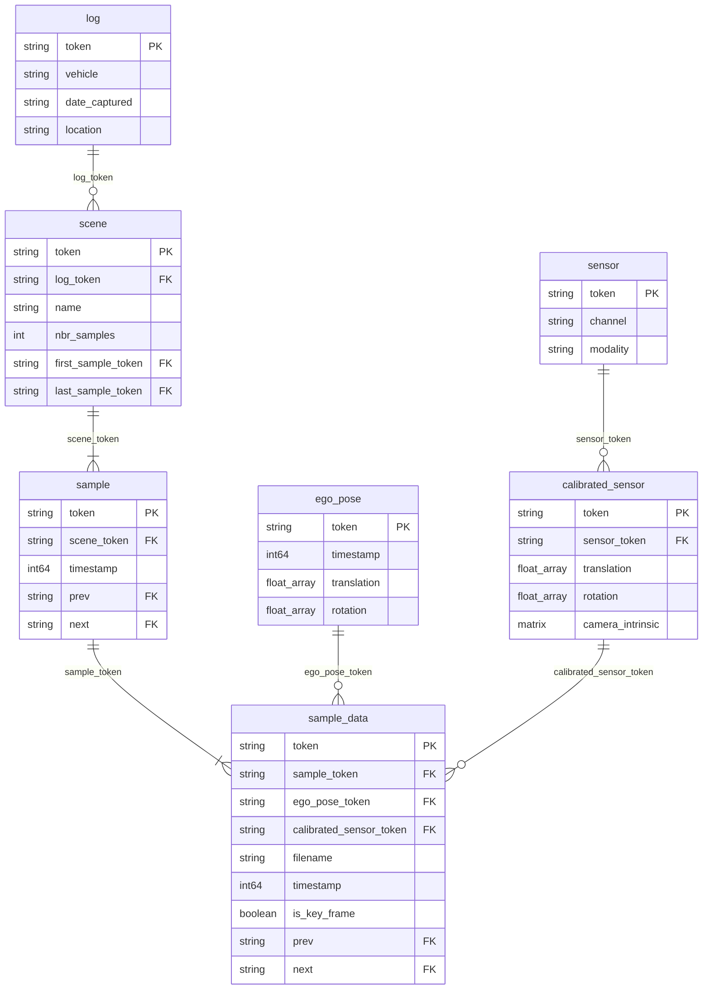

`scene`은 약 20초 주행 구간, `sample`은 약 0.5초 간격의 키프레임이다.
각 `sample_data`에는 센서 파일 경로와 관측 시각, 해당 시점의 차량 자세·캘리브레이션 참조가 들어 있다.

#### 키프레임의 객체 주석

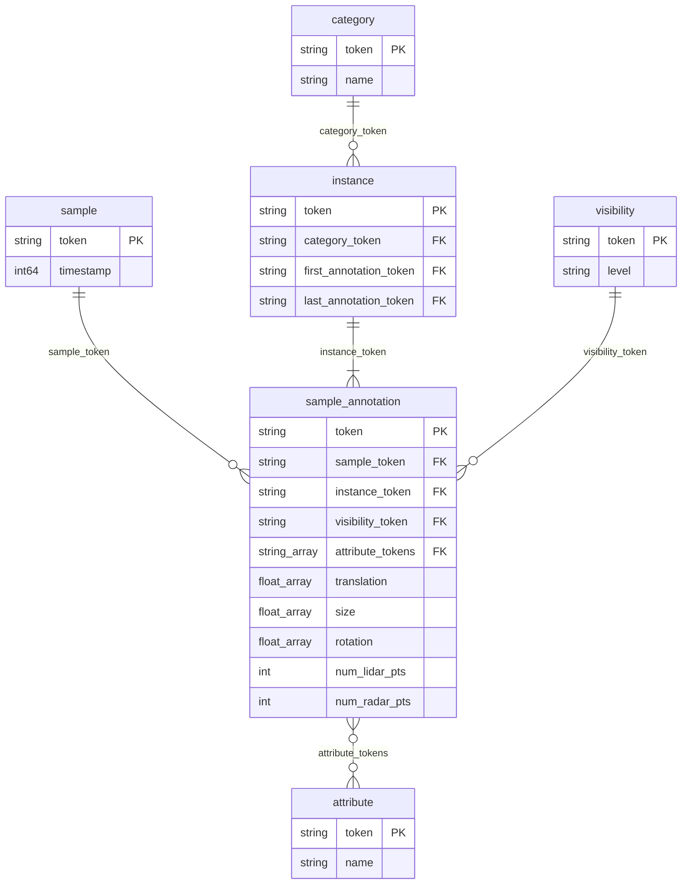

객체 주석은 `sample`에 연결된다. 같은 키프레임의 센서 파일과 객체 박스를 함께 조회할 수 있다.
`instance`는 한 장면 안에서 같은 객체의 주석을 연결하고, `category`는 차량·보행자 등의 분류를 나타낸다.
위의 FK 표시는 JSON 테이블 간 참조 관계다.

<details>
<summary>nuScenes 공식 전체 스키마</summary>


출처: [nuScenes 공식 스키마 정의](https://github.com/nutonomy/nuscenes-devkit/blob/master/docs/schema_nuscenes.md).

</details>

#### 키프레임과 스윕

센서는 키프레임 사이에도 관측을 계속한다. 이 중간 관측을 **스윕(sweep)**이라고 부른다.
아래 그림은 관측 순서를 단순화한 것이다.

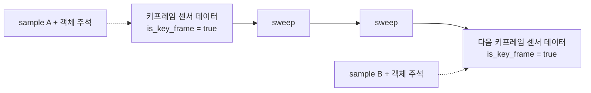

센서별 `sample_data.prev/next` 체인을 순회하면 키프레임과 스윕을 모두 읽을 수 있다.
비키프레임의 `sample_token`은 시간상 가장 가까운 **다음 sample**을 참조한다.
[공식 sample_data 규칙](https://github.com/nutonomy/nuscenes-devkit/blob/master/docs/schema_nuscenes.md#sample_data)

mini 센서 파일의 **84.5%가 스윕**이다. 원본 보존 시 전체 체인을 순회하고 파일 수를 대조한다(§10.2).

### 2.2 원천과 프로젝트 레코드의 대응

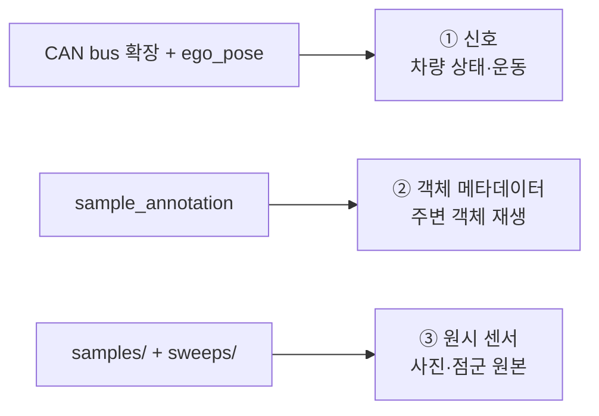

CAN bus 확장은 별도로 내려받는다. 객체 메타데이터에는 사람이 작성한 3D 주석을 사용한다.

### 2.3 회전과 위치 표현

**쿼터니언(quaternion)**은 물체의 방향과 회전을 표현하는 데 사용한다.
3차원 회전은 **어떤 축을 중심으로 얼마나 돌리는가**로 설명할 수 있다.
단위 쿼터니언은 이 회전축과 회전각을 네 값 `(w, x, y, z)`에 담는다.
회전각이 θ일 때 `w = cos(θ/2)`, `(x, y, z) = 단위 회전축 × sin(θ/2)`로 표현한다.
예를 들어 z축을 중심으로 90° 회전하면 약 `(0.7071, 0, 0, 0.7071)`이다.
[회전축·각도와 쿼터니언의 관계 — SciPy 공식 문서](https://docs.scipy.org/doc/scipy/reference/generated/scipy.spatial.transform.Rotation.from_quat.html)

이 프로젝트에서는 다음 세 곳에 사용한다.

- **차량 자세:** `ego_pose.rotation`으로 지도 좌표계에서 차량이 향하는 방향과 기울기를 나타낸다.
- **센서 장착 방향:** `calibrated_sensor.rotation`으로 센서 좌표를 차량 좌표로 회전시킨다. 장착 위치의 평행이동을 함께 적용해 점군을 정렬한다(§7.2).
- **객체 박스 방향:** `sample_annotation.rotation`으로 주변 차량·보행자의 3D 박스를 해당 방향으로 배치한다.

회전을 나타내는 단위 쿼터니언은 크기가 1이므로 `√(w²+x²+y²+z²) ≈ 1`을 검증한다(§8.3).
nuScenes의 성분 순서는 `(w, x, y, z)`이며, 재생기는 Rerun에 전달할 때 `(x, y, z, w)`로 순서를 바꾼다.
회전의 합성·역변환과 정규화 예시는 [ROS 2의 쿼터니언 기초 설명](https://github.com/ros2/ros2_documentation/blob/rolling/source/ROS-Framework/interfaces/Working-with-interfaces/Quaternion-Fundamentals.rst)에서 확인할 수 있다.

**ENU(East-North-Up)**는 지도 원점을 기준으로 동쪽·북쪽·위쪽 거리를 미터로 표현하는 좌표계다.
`ego_pose.translation`에 이 좌표를 사용하며, 지도 표시용 위경도 변환은 §7에서 설명한다.

---

## 3. 원천 데이터

### 3.1 데이터셋 규모와 센서 구성

[nuScenes](https://www.nuscenes.org/)는 보스턴·싱가포르의 실도로에서 수집한 자율주행 데이터셋이다.
전체 공개본은 약 20초 길이의 1,000장면으로 구성된다. 이 프로젝트는 **v1.0-mini 10장면**을 사용한다.

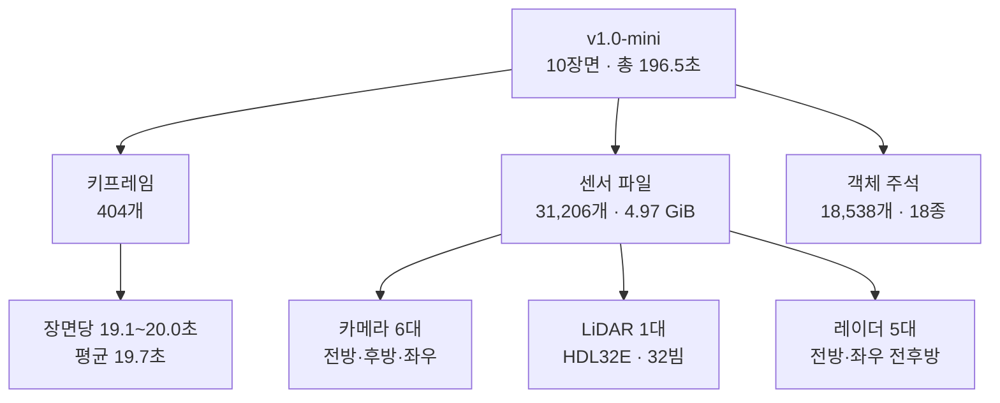

원천 수집 차량은 두 대이며, 수집 지역은 보스턴과 싱가포르다.
**CAN bus 확장은 별도로 내려받아야 한다.** 데이터는 [nuScenes 이용 약관](https://www.nuscenes.org/terms-of-use)에 따라 로컬에서 관리한다.

### 3.2 장면 길이와 시간 간격

각 장면은 긴 주행에서 선택한 약 20초 구간이다. 장면 전환 시 위치와 시각이 바뀌므로,
지오펜스 체류 시간 같은 연속 분석은 장면별로 나누어 처리한다.
장시간 운행 분석에는 연속 로그나 별도 시뮬레이션이 필요하다.

### 3.3 동시 재생 스트림

재생기는 장면마다 가상 `vehicle_id`를 부여해 N개 스트림을 동시에 생성한다.
N은 **동시 재생 스트림 수**이며, 두 원천 차량의 데이터를 재사용한다.

---

## 4. 채널별 발생량

`measure_dataset.py`의 기존 mini 10장면 측정값이다. 원시 센서·객체는 스팬 합 **196.5초**,
신호는 **199.5초**를 기준으로 계산했다. KiB = 1,024 B, MiB = 1,024 KiB다.

### 4.1 원시 센서: 12채널, 25.89 MiB/s

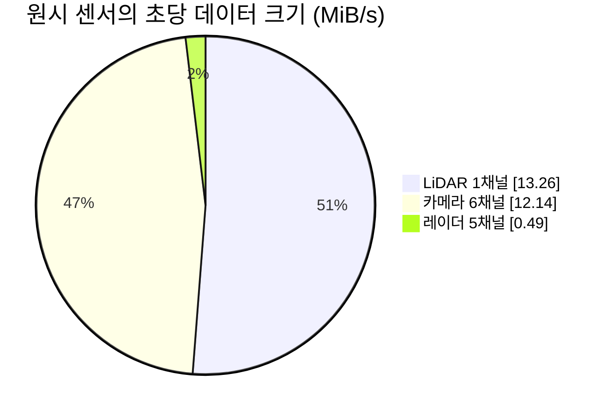

LiDAR 한 채널이 원시 데이터 크기의 약 절반을 차지한다.
프레임당 약 3.5만 포인트를 float32 5개(x, y, z, intensity, ring)로 저장한다.
카메라는 1600×900 JPEG, 레이더는 텍스트 헤더와 바이너리를 갖는 PCD 형식이다.
전체 발생량을 10진 단위로 환산하면 **27.15 MB/s**다.

<details>
<summary>센서 종류별 형식·주기·파일 크기</summary>

- **LiDAR 1채널:** 20.0 Hz, 평균 678.1 KiB/파일. `LIDAR_TOP`.
- **카메라 6채널:** 11.8~11.9 Hz, 평균 157.8~183.2 KiB/파일. 전방·후방과 각각의 좌우 채널.
- **레이더 5채널:** 13.4~13.7 Hz, 평균 5.4~9.1 KiB/파일. 전방·좌우 전후방 채널.

전체 발생량은 **158.8 파일/s**다. 상세 채널별 수치는 [측정 스크립트](../exploration/scripts/measure_dataset.py)로 확인한다.

</details>

### 4.2 차량 신호: 7채널, 1,307.7 레코드/s

레코드 하나는 한 채널의 한 샘플이다. mini 전체 신호는 **260,890건**이다.

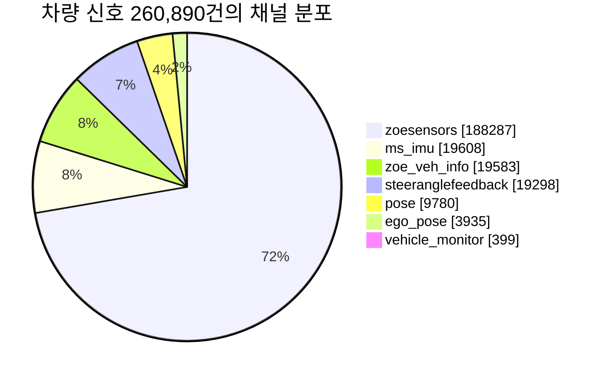

페달·조향 센서인 `zoesensors`가 **943.8 Hz**로 신호 건수의 **72.2%**를 차지한다.
`ego_pose`는 `LIDAR_TOP` 체인에서 읽어 19.7 Hz로 구성한다.

<details>
<summary>채널별 주기와 주요 필드</summary>

- **`zoesensors` — 943.8 Hz, 188,287건:** `brake_sensor`, `steering_sensor`, `throttle_sensor`.
- **`ms_imu` — 98.3 Hz, 19,608건:** `linear_accel[3]`, `q[4]`, `rotation_rate[3]`.
- **`zoe_veh_info` — 98.2 Hz, 19,583건:** 바퀴별 속도 4종, `odom`, `steer_raw`, `meanEffTorque`, `regen` 등 17필드.
- **`steeranglefeedback` — 96.7 Hz, 19,298건:** 조향 휠 회전각 `value`(rad).
- **`pose` — 49.0 Hz, 9,780건:** `pos`, `vel`, `accel`, `orientation`, `rotation_rate`.
- **`ego_pose` — 19.7 Hz, 3,935건:** `translation[3]`, `rotation[4]`, 파생 `lat`/`lon`, `location`.
- **`vehicle_monitor` — 2.0 Hz, 399건:** `vehicle_speed`, `yaw_rate`, `steering`, `brake`, `throttle`, `gear_position`, 바퀴 rpm 2종, `battery_level`, 방향지시등 등 14필드.

전송 헤더·장면·채널·시각을 포함한 JSON 레코드의 평균 크기는 **363 B**다.

</details>

재생용 `SignalRecord`는 ego_pose 시각에 CAN 값을 최근접 결합해 만든다.
결과는 **19.7 Hz, 3,935건**이며, 각 채널의 원천 샘플은 채널별 레코드로 관리한다.
클라우드로 보낼 레코드는 수집 정책에 따라 선택하고 영속 outbox에 기록한다.

### 4.3 객체 메타데이터: 18,538개 박스

키프레임은 약 **2 Hz**, 프레임당 객체는 평균 **45.9개**, 최대 **156개**다.
객체 레코드는 평균 약 **420 B**, 전체는 약 **39 KiB/s**다.
키프레임 하나의 객체를 배열로 전송할 때는 최대 배치 크기를 확인해야 한다.

### 4.4 동시 스트림 수에 따른 발생량

원천 전량을 재생할 때의 예상 발생량은 동시 스트림 수 N에 비례한다.

```text
신호 레코드/초 = 1,307.7 × N
신호 데이터/초 = 464 KiB × N       (JSON 레코드 평균 363 B)
원시 데이터/초 = 25.89 MiB × N
```

실제 클라우드 전송량은 보고 간격·선택 채널·집중 관찰 비율·이력 요청량으로 산정한다.
동시 접속 목표와 전송 정책은 [SDD](sdd.md)에 정리했다.

---

## 5. 필드 계약

세 레코드는 **무엇을 관측했는지**를 나타내고, 전송 헤더는 **어떤 차량이 어떤 전송 항목으로 보냈는지**를 나타낸다.

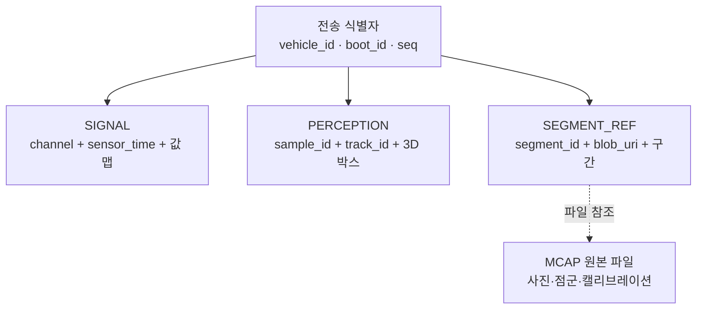

`track_id`는 주변 객체, `segment_id`는 원본 파일, `vehicle/boot/seq`는 전달 레코드의 식별자다.
아래 표에 각 레코드의 필드명·타입·제약 조건을 정리했다.

### 5.0 전송 식별자와 Kafka 헤더

Kafka 파티션 키는 `vehicle_id`, 저장 레코드 식별 키는 **`(vehicle_id, boot_id, seq)`**다.
다음 값은 Avro 본문과 분리해 Kafka 헤더에 저장하며, 수치는 UTF-8 문자열로 전달한다.

| 헤더 | 의미 |
|---|---|
| `vehicle_id` | 인증된 차량 식별자 |
| `boot_id` | gRPC WAL의 생애 ID. MQTT에서는 차량·원천 boot·stream으로 생성한 UUIDv5 |
| `seq` | 영속 수용한 레코드의 순번. MQTT는 stream별 발급 |
| `kind` | SIGNAL / PERCEPTION / SEGMENT_REF |
| `source_boot_id` | MQTT outbox의 원래 생애 ID |
| `stream_id` | MQTT 전달 목적: `status` / `event` / `history` |
| `report_interval_ms` | MQTT 보고 간격. 최신성·미수신 판단에 사용 |

MQTT는 stream별 `boot_id`를 생성해 같은 `seq`의 충돌을 피한다. 재전송에도 같은 식별 키를 유지한다.
인증·배치·ACK·중복 제거의 상세 계약은 [MQTT 수집 계약](mqtt-contract.md#2-저장ack중복-제거의-상세-계약)를 따른다.

### 5.1 신호 (`vehicle-signal`)

레코드 하나는 **한 채널의 한 샘플**이다. 값은 타입별 맵에 담는다.
스키마: [vehicle-signal.avsc](../schemas/vehicle-signal.avsc).

<details>
<summary>신호 필드와 채널별 값 제약 펼치기</summary>

| 필드 | 타입 | 제약 | 설명 |
|---|---|---|---|
| §5.0 전송 헤더 | — | PK = `(vehicle_id, boot_id, seq)` | |
| `scene_id` | string | NOT NULL | 소속 장면 |
| `channel` | string | NOT NULL | 신호 채널명. nuScenes 원천 채널은 §4.2 참조 |
| `sensor_time` | timestamp-micros | NOT NULL | **센서 클럭.** 정본 시간축 |
| `log_time` | timestamp-micros | NOT NULL | 온보드 기록 시각 |
| `values_num` | map\<double\> | NOT NULL (빈 맵 허용) | 속도·조향각 등 스칼라 값 |
| `values_vec` | map\<array\<double\>\> | NOT NULL | 위치·가속도 등 3차원 벡터, 4성분 쿼터니언 |
| `values_str` | map\<string\> | NOT NULL | 문자열 값. 현재 `location` 하나 |

타입별 맵은 Flink·ClickHouse에서 값마다 타입을 분기하는 처리를 줄인다.

null은 해당 키를 생략해 표현한다. `lat`/`lon` 변환 실패에도 같은 규칙을 적용한다.

`ego_pose` 채널의 `values`:

| 키 | 타입 | 제약 | 설명 |
|---|---|---|---|
| `translation` | array\<double\>[3] | z는 항상 0 | ENU 로컬 미터(§7) |
| `rotation` | array\<double\>[4] | \|q\| ≈ 1 | 쿼터니언 (w, x, y, z) |
| `lat` / `lon` | double | nullable | WGS84 파생(§7). 변환 실패 시 null |
| `location` | string | NOT NULL | 4개 지역 중 하나 |

CAN 채널의 주요 값 제약:

| 키 | 채널 | 제약 |
|---|---|---|
| `value` (조향각) | `steeranglefeedback` | 조향 휠 회전각. mini 범위 **[-5.13, 5.48] rad**. 전체 데이터셋 범위는 추가 측정 예정 |
| `vehicle_speed` | `vehicle_monitor` | >= 0. mini 실측 [0, 53.8] |
| `rotation_rate` | `ms_imu` | array[3], z가 yaw rate |

</details>

### 5.2 객체 메타데이터 (`perception-object`)

레코드 하나는 **3D 박스 하나**다. 스키마: [perception-object.avsc](../schemas/perception-object.avsc).

<details>
<summary>객체 메타데이터 필드 펼치기</summary>

| 필드 | 타입 | 제약 | 설명 |
|---|---|---|---|
| §5.0 전송 헤더 | — | PK = `(vehicle_id, boot_id, seq)` | |
| `scene_id` / `sample_id` | string | NOT NULL | 장면 / 키프레임 |
| `sensor_time` | timestamp-micros | NOT NULL | 키프레임 시각 |
| `track_id` | string | NOT NULL | 같은 scene 안에서 프레임 간 객체를 연결하는 식별자 |
| `category` | string | NOT NULL | `vehicle.car`, `human.pedestrian.adult` 등 (분류체계 23종) |
| `attribute` | string | nullable | `vehicle.moving` / `vehicle.parked` / `pedestrian.standing` 등 |
| `center_x/y/z` | double | NOT NULL | 박스 중심 (**글로벌 프레임**, m) |
| `size_w/l/h` | double | > 0 | **(width, length, height)** 순서 — §10.3에서 실측 확정 |
| `rot_w/x/y/z` | double | \|q\| ≈ 1 | 박스 자세 쿼터니언 |
| `visibility` | string | NOT NULL | `v0-40` / `v40-60` / `v60-80` / `v80-100` — 카메라에 보이는 비율 |
| `num_lidar_pts` | int | >= 0 | 박스 안의 LiDAR 포인트 수. 0은 거리나 가림 때문에 정상적으로 발생할 수 있다(§8.1) |
| `num_radar_pts` | int | >= 0 | 박스 내 레이더 포인트 수 |

</details>

### 5.3 원시 로그 참조 (`segment-ref`)

원시 센서 파일은 오브젝트 스토리지에 저장하고, `segment-ref`로 위치와 시간 범위를 조회한다.
3D 재생에 필요한 캘리브레이션도 함께 보관한다.
스키마: [segment-ref.avsc](../schemas/segment-ref.avsc).

<details>
<summary>원본 파일 참조 필드 펼치기</summary>

| 필드 | 타입 | 제약 | 설명 |
|---|---|---|---|
| §5.0 전송 헤더 | — | PK = `(vehicle_id, boot_id, seq)` | |
| `segment_id` | string(ULID) | UNIQUE | 원본 파일의 식별자 |
| `scene_id` | string | nullable | 재생 장면 식별자 |
| `blob_uri` | string | NOT NULL | 로그 파일 위치 |
| `t_start` / `t_end` | timestamp-micros | NOT NULL | 세그먼트 시간 범위 |
| `sensor_channels` | array\<string\> | NOT NULL | 포함 채널 목록 |
| `size_bytes` | long | > 0 | |
| `checksum` | string | NOT NULL | sha256 — 무결성 검증 |
| `sample_count` | int | > 0 | MCAP 메시지 수 |
| `state` | enum | NOT NULL | `UPLOADED` / `DROPPED` |
| `drop_reason` | string | nullable | 업로드 포기 사유 |
| `calibration` | map\<string\> | NOT NULL | 3D 재구성에 사용하는 채널별 외부·내부 파라미터(§7.2) |

</details>

### 5.4 실패 격리 (`dlq-envelope`)

[dlq-envelope.avsc](../schemas/dlq-envelope.avsc)는 실패한 원본 바이트와 오류 종류·상세·처리 단계·시각·재시도 횟수를 보관한다.
오류 종류는 파싱, 스키마 검증, 업무 규칙, 저장 실패의 네 가지다.

---

## 6. 시간 계약

### 6.1 발생·기록·수신 시각의 분리

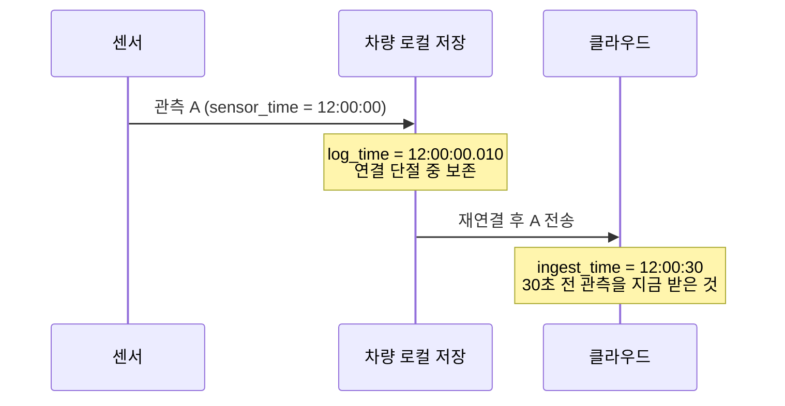

발생·기록·수신 시각을 분리한다. 전송 지연 계산에는 센서와 서버의 시계 동기화가 필요하다.

| 타임스탬프 | 부여 주체 | 용도 |
|---|---|---|
| `sensor_time` | 센서 자체 클럭 | **정본 시간축** — 파티션·정렬 기준 |
| `log_time` | 온보드 기록 시점 | 온보드 버퍼링 지연 관측 |
| `ingest_time` | 수신 시점 | 수신 이력, 시계 동기화 시 전송 지연 계산 |

### 6.2 키프레임 기준의 센서 시간 정렬

`sample`은 가까운 시각의 센서 관측과 3D 주석을 연결한다.
실제 결합에는 파일별 timestamp와 허용 시간 차이를 사용한다.

### 6.3 지연 이력의 저장과 현재 상태 반영 분리

업로드 대상으로 수용한 이력은 원래 `sensor_time`으로 저장한다.
`history` stream은 현재 경보 입력에서 제외하고, MQTT 상태 재전송도 발생 시각의 최신성을 검사한다.
조회 API는 발생 시각을 기준으로 최신 좌표를 선택한다.

보고 주기는 로컬 수신 시각으로 제어하고, 각 레코드에는 원래 센서 발생 시각을 유지한다.
`history_request`의 구간 선택은 현재 로컬 ring 수신 시각 기준이다.
Flink 최신성·미수신 판단은 보고 간격을 반영한다. 현 기본값과 시계 동기화 조건은 [SDD S-11](sdd.md)을 따른다.

---

## 7. 좌표 계약

### 7.1 ENU → WGS84

`ego_pose.translation`은 지역 지도의 ENU 미터 좌표이며 `z = 0`이다.
원본 좌표를 유지하면서 지도 표시용 `lat`/`lon`을 파생한다. 변환 실패 시 좌표만 null로 두고 행은 보존한다.

지역별 원점은 [geo.py](../exploration/fleetsentinel_ingest/geo.py)에 정의한다.
GeoJSON에는 **`[lon, lat]` 순서**로 전달한다.

### 7.2 센서 좌표 → 차량 좌표 → 지도 좌표

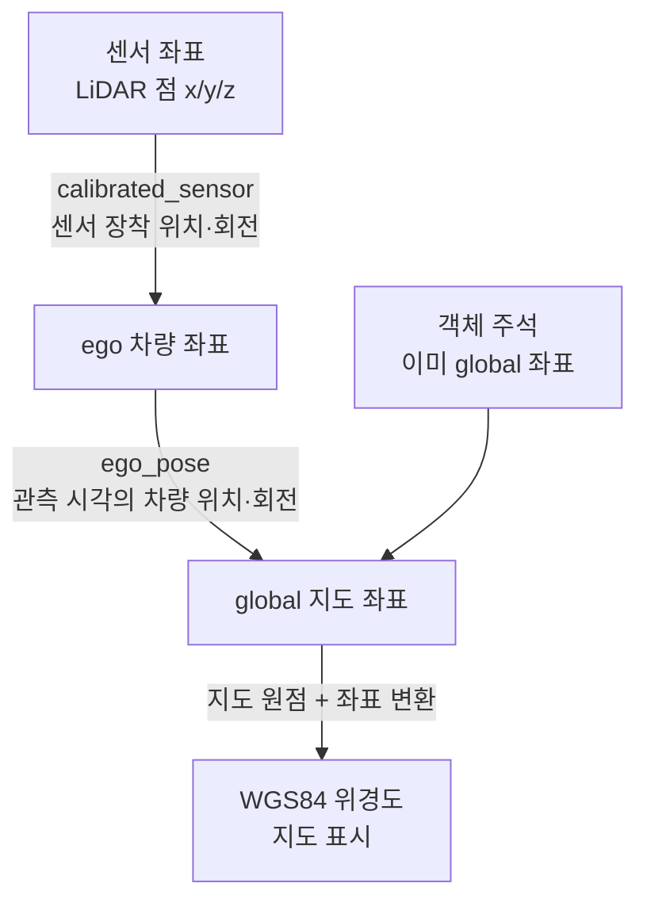

**점군을 global로 옮긴 뒤 같은 좌표의 객체 박스와 비교한다.**
객체 박스는 원천의 global 좌표를 사용한다.
카메라에 겹쳐 그릴 때는 global에서 카메라 좌표로 역변환한 뒤 내부 파라미터로 픽셀에 투영한다.

센서 외부 파라미터(extrinsics)는 차량에 장착된 센서의 위치와 회전을 나타낸다.
점군과 객체 박스를 같은 좌표계로 정렬할 때 사용하며, 원본 파일의 `calibration`에 함께 보관한다.

카메라 내부 파라미터(intrinsics)는 초점거리·주점을 담는 3×3 행렬이다.
카메라 좌표의 3D 점을 이미지 픽셀로 투영할 때 사용한다.

---

## 8. 관제에서 해석할 때 주의할 원천 특성

### 8.1 객체 주석의 관측값과 분포

`num_lidar_pts`는 박스 안의 LiDAR 포인트 수다. mini 주석의 **23.1%가 0**이며,
거리·가림을 고려해 정상 값으로 유지한다. `visibility`는 카메라에 보이는 비율의 구간이다.

클래스별로는 승용차와 성인 보행자가 **66.8%**를 차지한다. 클래스별 결과를 비교할 때 이 분포를 고려한다.
레이더는 현재 원본 파일과 주석의 포인트 수를 보관한다.

### 8.2 장면 설명에서 추출하는 환경 정보

`scene.description`은 자유 텍스트다. 기록된 조건과 태그 부재에서 추정한 조건을 구분한다.
예를 들어 `after rain`은 **강우 후**로 분류하고, 현재 강우 여부는 별도로 확인한다.

### 8.3 검증 규칙

| 규칙 | 대상 | 위반 시 |
|---|---|---|
| 조향각이 물리 범위 안 | 신호 | `BUSINESS_RULE_FAILURE` → DLQ. **경계값은 full 데이터셋 측정 후 확정**(mini는 [-5.13, 5.48]) |
| 속도 >= 0 | 신호 | `BUSINESS_RULE_FAILURE` → DLQ |
| 쿼터니언 \|q\| ≈ 1 | 신호·객체 메타데이터 | `BUSINESS_RULE_FAILURE` → DLQ |
| 박스 크기 > 0 | 객체 메타데이터 | `BUSINESS_RULE_FAILURE` → DLQ |
| `sensor_time` 단조성 (차량별) | 신호 | 경고 태그와 함께 행 유지 |
| `num_lidar_pts` = 0 | 객체 메타데이터 | 정상 값으로 행 유지 |
| 키프레임에 12센서 미충족 | 원시 | 세그먼트에 센서 결손 플래그 |
| `checksum` 불일치 | 원시 | `SINK_WRITE_FAILURE` → 재업로드 |

---

## 9. 저장 구조와 조회 용도

### 9.1 ClickHouse 테이블과 조회 뷰

현재 [ClickHouse DDL](../infra/clickhouse/001-schema.sql)을 기준으로 주요 컬럼을 표시했다.
세 테이블은 각각 신호·객체·원본 파일 참조를 저장한다.

세 테이블은 공통으로 `vehicle_id`, `boot_id`, `seq`, `ingest_time`을 갖는다.
아래는 데이터 종류별 주요 컬럼이다.

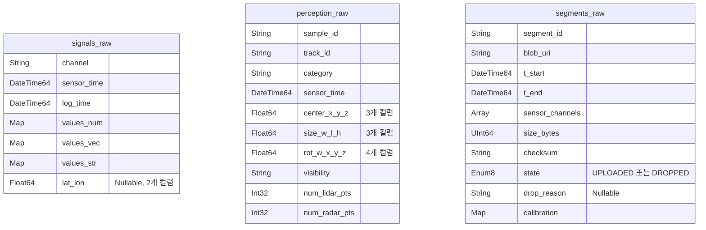

공통 엔진은 `ReplacingMergeTree(ingest_time)`, 정렬 키는 `(vehicle_id, boot_id, seq)`다.
신호·객체는 `sensor_time`, 세그먼트는 `t_start`의 날짜로 파티셔닝한다.
같은 레코드의 재수신은 정렬 키로 식별하고, 조회 뷰에서 `FINAL`을 적용한다.
그림의 좌표·크기·회전 필드는 묶어 표시했다. 전체 컬럼과 타입은 DDL을 따른다.

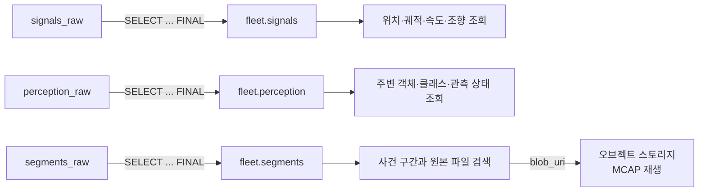

---

## 10. 검증

기존 검증 결과와 범위를 요약했다. 측정·MCAP 검증 명령은 [탐색 도구 안내](../exploration/README.md#실행)에 있다.

### 10.1 좌표 변환

mini 10장면의 좌표가 지도 범위 안에 들어왔고, 거리 보존 오차는 0.014% 이하였다.
ENU↔WGS84 왕복 오차는 계약 점에서 최대 0.024mm, 원점 1m 이내에서는 약 3mm였다.
Python·Flink 구현은 624개 좌표의 변환 결과를 대조했다.

### 10.2 무손실 보존

`verify_mcap.py`로 MCAP의 원시 센서 파일 수를 원천 `sample_data`와 대조한다.
기존 검증에서는 scene-0061·0103·0553의 **총 9,197개 파일**이 일치했다.
대상에는 키프레임과 스윕을 모두 포함한다.

### 10.3 좌표 변환과 박스 축 순서 검증

3D 박스 안의 LiDAR 포인트를 세어 원천 라벨의 `num_lidar_pts`와 대조했다.
76개 객체에서 **31,911개 포인트**가 일치했다.

박스 크기는 `(width, length, height)` 순서다.
박스 로컬 x축은 길이 방향이므로 좌표 계산의 반크기는 **`(length/2, width/2, height/2)`**를 사용한다.

### 10.4 추가 검증 항목

- full 데이터셋의 채널별 발생량과 조향각 범위 측정.
- 나머지 7장면의 좌표 변환·박스 내 포인트 수 대조.
- 레이더 PCD 디코딩과 좌표 변환 검증.

---

## 11. 관련 설계 문서

- **전송 정책과 아키텍처:** [SDD](sdd.md) · [MQTT 전환 설계](mqtt-migration.md).
- **배치·ACK·로컬 보존:** [MQTT 수집 계약](mqtt-contract.md).
- **기존 gRPC 경로:** [SDD §3 S-7](sdd.md)의 유지 범위와 복구 계약.
- **직렬화:** `schemas/*.avsc`의 Avro 정의.
- **저장 계층:** [ClickHouse 테이블·뷰 DDL](../infra/clickhouse/001-schema.sql).

---

## 참고

- [nuScenes: A multimodal dataset for autonomous driving (arXiv:1903.11027)](https://arxiv.org/abs/1903.11027)
- [nuScenes 공식 사이트](https://www.nuscenes.org/) · [스키마 정의](https://github.com/nutonomy/nuscenes-devkit/blob/master/docs/schema_nuscenes.md)
- [CAN bus 확장](https://github.com/nutonomy/nuscenes-devkit/blob/master/python-sdk/nuscenes/can_bus/README.md)
- [map_api.py — 지도 원점 좌표](https://github.com/nutonomy/nuscenes-devkit/blob/master/python-sdk/nuscenes/map_expansion/map_api.py)
