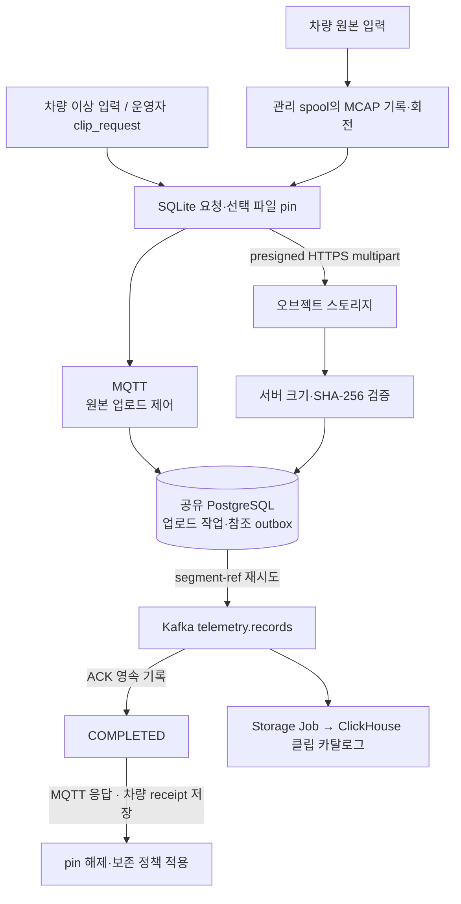
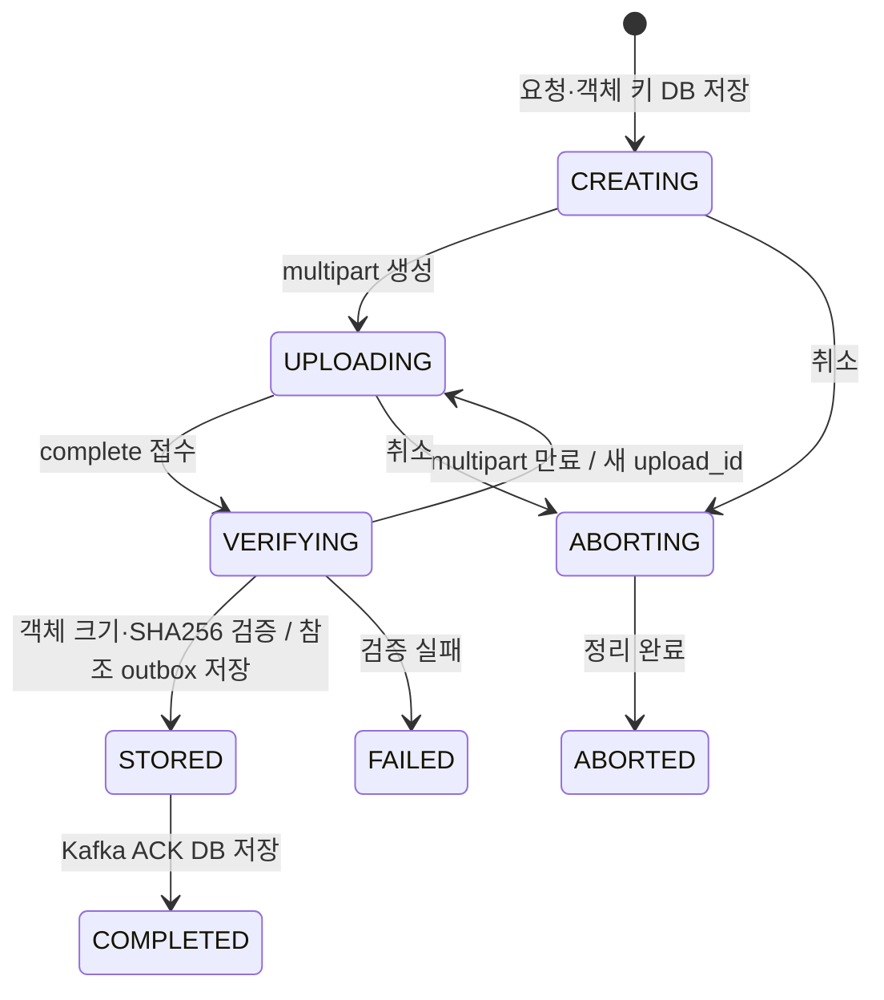

# FleetSentinel — System Design Document (v3.2)

| 항목 | 값 |
|---|---|
| 버전 | 3.3 — MQTT 원본 업로드 제어 |
| 상태 | 로컬 구현 / 기존 gRPC 수집 유지 / 클라우드 운영 전환 전 |
| 최종 갱신 | 2026-10-27 |
| 변경 범위 | 원본 기록·보존, 클립 명령, MQTT 업로드 제어, 공유 DB와 참조 outbox |
| 관련 문서 | [전환 근거](mqtt-migration.md) · [MQTT 수집 계약](mqtt-contract.md) · [데이터 설계](data-design.md) |

이 문서는 **현재 시스템 설계의 정본**이다. 이전의 고주파 gRPC·저주파 MQTT 구분과 전량 전송 전제를 대체한다.
기존 gRPC 수집은 회귀·재생 경로로 유지한다. 원본 업로드 제어는 MQTT로 통일하며,
새 코드에서 SegmentUpload와 `ship_segments`를 제거했다. 이 버전을 적용하기 전에 기존 배포에서
진행 중 업로드와 참조를 drain해야 한다(§5.2).

수치는 **원천 데이터 실측**, **설계 목표**, **설정 기본값**, **검증 결과**로 구분한다.
nuScenes 원천의 발생량은 [데이터 설계 §4](data-design.md)의 값이며, 선택 정책 적용 후 클라우드 입력량과 같지 않다.
차량 1,000~10,000대 동시 접속은 설계 목표다. 실제 원천 차량은 2대이며, 재생 스트림 수를 실차 검증 수로 표현하지 않는다.

---

## 1. 개요

### 1.1 서비스 목적과 범위

차량 상태를 클라우드에서 관제하고 이상 상황의 상세 이력·원본을 확인하는 플랫폼이다.

평상시에는 필요한 상태를 준실시간으로 받고, 이상 상황이나 관제자의 집중 관찰 요청 시 선택한 차량·신호의 전송 빈도를 높인다.
업로드 대상으로 선택해 영속 기록한 데이터는 통신 장애 중 보존하고 저장 확인 전까지 재전송한다.

대상은 데이터 수집·저장·관제·경보 전달이다. 차량의 안전 제어를 클라우드에 의존시키는 설계가 아니며,
센서별 허용 지연과 최초 이상 판단의 차량/클라우드 분담은 실제 업무 정책으로 확정해야 한다.

### 1.2 데이터 계층

차량 한 대가 만들어내는 데이터는 성격이 완전히 다른 **세 계층**으로 갈린다 —
**① 신호**(CAN·IMU·조향·자세), **② 객체 메타데이터**(3D 박스·트랙), **③ 원시 센서**(카메라 6대·
LiDAR·레이더 5대).

원본 파일과 관제 상태는 크기·용도·허용 지연이 다르므로 전달 경로를 분리한다.
고주파 원천 데이터의 발생량을 그대로 클라우드 전송 요구량으로 사용하지 않는다.

> 계층별 실측 수치(Hz·크기·형식·채널별 상세)는 **[데이터 설계 §1, §4](data-design.md)** 이
> 정본이다. 이 문서는 수치를 다시 적지 않고 설계 판단만 다룬다.

### 1.3 데이터 원천

**nuScenes** — 보스턴·싱가포르 실도로에서 수집된 공개 자율주행 데이터셋이다.
원래 타임스탬프대로 재생해 실시간 스트림으로 사용한다. 공개 로그 재생은 실제 차량
연동 없이 수집·처리·관제 경로를 검증하기 위한 입력이다.

### 1.4 시스템 아키텍처

#### 선택적 텔레메트리 수집과 하행 명령

```text
차량 센서 어댑터
  ├─ 최근 상세 이력 → 로컬 ring buffer → 기간·용량 기준 삭제
  └─ 수집 정책 / 이상 입력 / 이력 요청
       → durable outbox (status / event / history)
       → MQTT 5 브로커 (mTLS, QoS 1)
       → 수집 bridge
       → Kafka telemetry.records
            ├─ Storage Job → ClickHouse → 조회 API
            ├─ Alert Job   → Kafka fleet.alerts → API → SSE
            └─ 검증 실패   → telemetry.dlq

Kafka 쓰기 완료 → bridge → MQTT application ACK → 차량 outbox 삭제
운영자 dispatcher → MQTT command → 차량 적용 → MQTT reported → 결과 기록
```

수집 빈도·채널 선택은 차량 정책의 책임이다. 브로커는 연결·구독·메시지 전달을,
bridge는 토픽/본문 검증·Kafka 적재·application ACK를 담당한다.
명령 발행과 차량 적용은 구분하며, 현재 관제 명령 인터페이스는 CLI다.

MQTT를 선택한 이유는 차량별 비동기 메시지 라우팅과 세션 관리에 브로커 기능을 활용하기 위해서다.
gRPC에서도 같은 선택 정책·배칭·양방향 명령을 구현할 수 있다. MQTT의 처리량 우위나 비용 절감을
입증했다는 뜻은 아니다. 비교 근거와 운영 부담은 [전환 문서 §2](mqtt-migration.md)에 있다.

기존 경로인 `차량 WAL → gRPC 게이트웨이 → Kafka`는 유지한다. MQTT 브로커 없이 gRPC만 증설하는 경우에도
장기 연결 분산·하행 명령 라우팅·Kafka 용량 계획은 필요하다. 인스턴스 추가만으로 확장 문제가 모두 해결되지는 않는다.

#### 원본 파일 업로드와 클립 참조



차량은 기록 중인 원본을 회전하고, 사건·요청과 겹치는 파일을 고정한다. 선택 목록과 명령 결과는
신호 outbox와 같은 SQLite DB에 저장한다. 업로드 worker는 신호 전송과 별도로 동작한다.
원본 트리거는 차량의 이상 입력과 운영자 CLI다. Flink 경보가 원본 요청을 자동 발행하는 연결과
실제 카메라·CAN·LiDAR 드라이버는 현재 범위에 포함하지 않는다.

원본은 MQTT/Kafka에 직접 싣지 않고 `blob_uri`·체크섬·시간 범위·캘리브레이션을 참조로 전달한다.
클립 참조의 Kafka 토픽도 `telemetry.records`이며 `kind` 헤더로 식별한다.
기존 [아키텍처 이미지](assets/fleetsentinel-architecture.png)는 v3.0 참고 자료이고 현재 경로는 위 흐름을 기준으로 한다.

### 1.5 기술 스택

버전은 저장소의 의존성·로컬 설정 기준이다. 최신 릴리스 여부나 운영 검증 범위를 뜻하지 않는다.

| 계층 | 채택 | 버전 | 근거 |
|---|---|---|---|
| 스트림 버스 | **Apache Kafka** (KRaft) | 4.x | 3-broker RF=3 / ISR=2로 broker-level HA 실증 |
| 스트림 처리 | **Apache Flink** | **2.0.0** | Docker 이미지와 Gradle 의존성을 같은 버전으로 고정. **PyFlink는 기각**(§4.1 A-13) — 커넥터·API 조합 때문이며 성능 문제는 아니다 |
| 원시 로그 저장 | 오브젝트 스토리지 + **MCAP** | — | 로컬 MinIO, 배포 대상의 S3 multipart API와 호환성을 검증한다. `s3://`는 객체 참조 형식이다 |
| 구조화 저장·질의 | **ClickHouse** | **26.3 LTS** (`:lts` 태그) | §4.1 A-8 |
| API | **Spring Boot** | **4.0.x** (2025-11 릴리스) | Spring Framework 7.x · Jakarta EE 11 · Servlet 6.1 |
| 원본 업로드 제어 | Spring Boot MQTT adapter · JPA · Flyway · PostgreSQL | 저장소 설정 기준 | MQTT mTLS·CN ACL, 공유 DB에 작업·검증 상태·참조 outbox 보존. 관리 포트 8082 |
| 기존 수집 | Spring Boot + Spring gRPC | 4.0.x / 1.0.3 | WAL·CACK 수집 유지. 제거된 SegmentUpload는 전환 전 기존 배포에서 drain |
| 프론트엔드 | **React + Vite** | — | 대시보드는 클라이언트 앱 — SSR 불필요 |
| 지도 | **MapLibre GL JS** | — | 오픈소스. 궤적이 많아지면 deck.gl 추가 |
| 시계열 차트 | **uPlot** | — | 시계열 특화, 경량 |
| 센서 재생 | **`@rerun-io/web-viewer-react`** | Rerun SDK와 동일 마이너 | 이미 만드는 `.rrd`를 그대로 임베드 |
| 차량 통신 | MQTT 5 / QoS 1 / mTLS | 로컬 Mosquitto 2.0.22 | 상태·이벤트·이력과 하행 명령. 브로커 HA는 미검증 |
| 차량 에이전트·수집 bridge | Python / Paho MQTT / confluent-kafka | Python 3.12 / Paho 2.1.0 | 선택 정책, Kafka 저장 확인, 재전송 및 명령 적용 |
| 차량 로컬 저장 | SQLite WAL + FULL synchronous | Python SQLite | 이력 ring과 durable outbox 분리; 기존 gRPC WAL 자동 변환 없음 |
| 실시간 푸시 | **SSE** | — | `/api/stream`은 텔레메트리 재생, `/api/alerts`는 Kafka 전이 이벤트. 서버→클라이언트 단방향이면 충분 |
| 데이터 탐색·재생 | Python | 3.12 | nuScenes 추출·MCAP·gRPC 재생. 같은 디렉터리에 MQTT 런타임도 존재 |

#### Java 버전이 모듈마다 다르다

Spring Boot 4 API는 Java 21로 실행하고, Docker의 Flink 2.0.0 이미지와 잡은 Java 17로 맞춘다.

| 모듈 | Java | 근거 |
|---|---|---|
| Spring Boot API | **21** (LTS) | SB4 지원 범위 안, 라이브러리 생태계 성숙. Java 25도 LTS이고 지원되나 성숙도를 보고 21 채택 |
| **수집 게이트웨이** | **21** (LTS) | API와 같은 런타임으로 맞춘다 — 둘 다 Spring Boot 4.0.x라 버전을 나눌 이유가 없다 |
| Flink 잡 | **17** | Flink 기본·권장. 실험적 지원을 감수할 이유가 없다 |

#### 채택하지 않은 것

| | 이유 |
|---|---|
| ~~Elasticsearch~~ | §4.1 **A-8** — 지리 인덱스가 불필요한 규모 + Kibana 대체됨 |
| ~~Kibana~~ | 자체 대시보드로 대체 |
| ~~BigQuery / 웨어하우스~~ | §4.1 **A-2** — 현재 관제 조회에 별도 분석 웨어하우스가 필요하지 않음 |
| ~~Apache Iceberg~~ | 관제용 시계열 조회에는 테이블 스냅샷 요구가 없고 카탈로그 운영이 추가되므로 제외. ClickHouse 싱크 중복은 동일 키와 FINAL 조회로 처리한다(S-7, L-14) |

### 1.6 구현 상태

| 범위 | 현재 상태 |
|---|---|
| 기존 gRPC 수집 | WAL·CACK 회귀·재생 경로 유지 |
| 사건 원본 수명주기 | 관리 spool, MCAP 회전, 사건·요청 pin, MQTT 제어 + HTTPS worker. 실차 드라이버 연동 전 |
| MQTT 업로드 제어 서버 | 공유 PostgreSQL 작업·참조 outbox, 객체 검증, Kafka ACK 후 완료 처리 |
| MQTT 수집 정책·보존·명령 | JSONL 차량 어댑터와 운영자 CLI로 로컬 구현 |
| MQTT→Kafka | 실제 브로커를 사용한 mTLS·ACL·재전송·저장 확인 테스트 수행 |
| Flink | Alert/Storage 독립 Job. MQTT 식별·history 제외·보고 간격별 watchdog 구현 |
| 조회 API·SSE·대시보드 | 기존 경로 유지. 최신 위치는 발생 시각 기준으로 조회 |
| 클라우드 운영·실차 연동 | 미완료. HA·명령 API 권한·기기 자원·대규모 연결 검증 필요 |

테스트 범위는 §6, 실제 전환 순서는 §5와 [MQTT 수집 계약](mqtt-contract.md)를 따른다.

---

## 2. 핵심 요구사항 및 문제 정의

기존 원천 데이터 분석에 상황별 수집·하행 명령·클라우드 운영 요구사항을 추가했다.
기존 P/S 식별자는 문서 참조를 위해 유지하되, 각 해법의 적용 범위는 변경된 요구사항을 기준으로 한다.

### 기능 요구사항

| ID | 요구사항 |
|---|---|
| R-1 | 업로드 대상으로 선택해 로컬 영속 저장에 성공한 데이터는 Kafka 저장 확인 전까지 보존·재전송 |
| R-2 | 보존 정책에 따라 선택한 사건 이력·원본을 나중에 조회·재처리 |
| R-3 | 평상시 저빈도·준실시간 관제, 이상/집중 관찰 시 선택 차량·신호의 전송 빈도 상향 |
| R-4 | 클라우드 운영을 목표로 하되 로컬에서 기능·장애 시나리오 재현 가능 |
| R-5 | 수집 정책 변경·상세 이력 요청·진단 명령 전달과 적용 결과 확인 |
| R-6 | 센서별 변화량·최대 보고 간격·로컬 보존 기준을 정책으로 관리 |
| R-7 | 평시 최초 이상 발견용 상태 보고 유지; 빠른 판단의 차량/클라우드 분담 명시 |

### 비기능 요구사항과 검증 상태

| 항목 | 설계 목표·기준 | 검증 상태 |
|---|---|---|
| 동시 접속 | 차량 1,000~10,000대 | 목표. 수용량 검증 전 |
| 가용성·확장 | 연결·세션, bridge, Kafka/Flink 처리량을 구분해 확장 | 로컬 단일 MQTT 브로커. 클라우드 HA 미검증 |
| 단절 복구 | outbox 재전송, 중복 저장 식별, 명령 멱등·만료 | 로컬 테스트 수행 |
| 전송·탐지 지연 | 정상/집중 관찰/이벤트별 허용 지연을 별도로 확정 | 구현 기본값만 존재. 실차 SLO 미확정 |
| 관제 조회 | p99 < 300ms | 설계 목표. MQTT 전환 후 부하 검증 전 |
| 비용·전력 | 전송량·메시지 과금·브로커·저장·연산·기기 자원 합산 | 실제 클라우드/기기 측정 전 |

유실 방지의 범위는 R-1의 **영속 수용에 성공한 업로드 대상**이다. 비선택 ring 이력의 정책상 삭제,
용량 초과로 수용하지 못한 입력, 디스크 고장, Kafka 보존 기간 밖 복구까지 무제한 보장하지 않는다.

### 문제

#### P-1. 원본 파일과 관제 상태의 전송·저장 비용 차이

원천 신호와 카메라·라이다 원본은 크기와 접근 방식이 다르다. 원본 발생량은 [데이터 설계 §4](data-design.md)를 참고한다.
모든 원본을 메시지 버스로 전달하는 방식은 네트워크·브로커·복제·보존 비용을 증가시킨다.
발생량에 차량 수를 곱한 값을 특정 Kafka 구성의 수용 한계로 단정하지 않는다.

#### P-2. 원본 연속 업로드의 비용과 무선망 변동

통신망 대역폭·요금·단절 시간이 정해지지 않은 상태에서 원본 연속 업로드를 기본으로 둘 수 없다.
특정 LTE 실효 속도를 모든 차량에 적용하지 않고, 사건·관제 요청 시 필요한 구간을 업로드하는 정책을 채택한다.

#### P-3. 전량 전송의 클라우드 처리량과 배칭 효과의 구분

원천 신호는 차량 스트림당 약 1,300 records/s지만, 이는 센서 발생량이지 재설계된 클라우드 입력량이 아니다.
평시에도 모든 샘플을 전달하면 브로커 이후의 연산·저장 비용이 계속 발생한다.

배칭은 여러 레코드를 한 전송 메시지로 전달하는 방법이다. 레코드 선택 없이 배칭만 적용하면
Kafka·Flink·DB에서 처리할 원천 레코드 수는 줄지 않는다. 선택 정책과 배칭을 별도로 결정해야 한다.

MQTT 처리량은 in-flight 설정·RTT·배치 크기·서버 자원 등에 영향을 받는다.
단일 설정의 `in-flight / RTT` 계산을 MQTT의 고정 처리량 상한으로 사용하지 않는다.

#### P-4. 센서마다 클럭도 주기도 다르다

943.8Hz부터 2.0Hz까지 **472배** 범위에 걸쳐 있고([데이터 설계 §4.2](data-design.md)), 각자 다른 클럭을 쓴다. 어느 시점의
카메라 프레임과 어느 LiDAR 스윕이 같은 순간인지 정의하지 않으면 조인이 성립하지 않는다.

#### P-5. 차량 좌표와 지도 표시 좌표의 변환

`ego_pose.translation`은 **지역 지도의 ENU 로컬 미터 좌표**이고 z는 항상 0이다.
지도 표시는 WGS84 위경도를 요구하므로, 지역별 원점과 좌표 변환 방식이 필요하다.

#### P-6. 원본 로그가 그 자체로 재생 가능해야 한다 (R-2)

센서마다 좌표 프레임이 다르다. LiDAR는 센서 프레임, 객체 박스는 글로벌 프레임이다.
**캘리브레이션이 함께 보존되지 않으면 원본이 있어도 3D로 재생할 수 없다.**

#### P-7. 재전송 중 중복 처리와 미확인 데이터 보존 (R-1)

현재 전달 경로는 at-least-once를 전제로 한다. Kafka 저장 전의 ACK, 과도한 중복 제거,
지연 이력을 현재 상태로 처리하는 동작이 각각 유실·오탐으로 이어질 수 있다.

#### P-8. 20초 클립이라 지속 부하를 만들 수 없다 (R-4)

전체 재생시간이 mini 195초, full로 가도 5.4시간이다. 루프하면 같은 레코드가 다시
들어오는데, 새 정체성을 주면 dedup을 검증할 수 없고 유지하면 전부 삼켜진다.

#### P-9. 차량 신원과 메시지 토픽·파티션 키의 바인딩 (R-1)

차량이 Kafka에 직접 접속하지 않더라도 외부 수집 경로의 인증·권한 검사가 필요하다.
인증된 차량 A가 차량 B의 토픽이나 식별자로 데이터를 보내지 못하게 해야 한다.
기존 gRPC는 인증서 SAN URI, MQTT는 인증서 CN과 토픽 ACL을 사용한다.

#### P-10. 관제 명령의 적용 확인과 단절 후 재실행

명령 발행 성공은 차량 적용 성공이 아니다. 재전송에 따른 중복 실행, 오래된 정책 복원,
연결 복구 뒤 만료된 명령 실행을 방지해야 한다.

#### P-11. 보고 간격 변경과 지연 이력에 따른 오탐

저빈도 보고를 통신 장애로 오인하거나, 과거 이력이 현재 위치·경보를 갱신하지 않도록
보고 간격과 발생 시각을 서버의 판단 기준에 포함해야 한다.

---

## 3. 해결 방법

수집·명령·저장 경로의 책임과 데이터 계약을 다음과 같이 정의한다.

### S-1 ← P-1. 원본 파일의 Claim-Check 경로

카메라·라이다 원본은 오브젝트 스토리지로 업로드하고, Kafka에는 참조·체크섬·시간 범위를 전달한다.
원본은 그대로 보존 정책의 대상이며 메시지 버스에서 픽셀·점군을 중계하지 않는다.
제어와 참조 메타데이터 전달은 MQTT, 본문 전송은 presigned HTTPS multipart를 사용한다.
차량 신원은 브로커의 인증서 CN·토픽 ACL로 바인딩한다. 관리 포트는 8082다.

#### 업로드 상태와 완료 조건



`COMPLETED`는 객체 검증과 참조의 Kafka 저장 확인이 모두 영속 기록된 상태다. 차량은 이 결과를
로컬 receipt로 저장한 뒤 파일의 pin을 해제한다. ClickHouse 카탈로그 반영은 하류 처리로 이어진다.
서버가 Kafka ACK를 받은 직후 중단되면 참조를 다시 발행할 수 있으므로 같은 식별자로 중복을 처리한다.

| MQTT operation | 계약 |
|---|---|
| `create` | 차량 파일 `request_id`와 불변 메타데이터 등록. 같은 요청은 같은 작업 반환 |
| `status` | 영속 작업 상태 조회 |
| `part_urls` | 필요한 part 번호의 URL과 현재 `upload_id` 반환 |
| `complete` | 현재 세대의 part 번호·ETag 접수, 비동기 객체 검증·참조 발행 |
| `cancel` | 검증 시작 전 취소. `VERIFYING` 이후 status 409 |

요청은 `fleet/v1/{vehicle_id}/clip/request`, 응답은 같은 차량의 `clip/response`다.
같은 차량·파일 `request_id`에 다른 메타데이터를 보내면 409다. 생성 응답 유실은 동일 본문으로,
완료 응답 유실은 상태 조회·동일 완료 요청으로 복구한다. 각 시도의 `correlation_id`와 operation을
대조해 늦은 응답을 버린다. MQTT PUBACK는 파일 등록 완료가 아니며 `COMPLETED` receipt가 필요하다.
메타데이터 필드 대응은 [데이터 설계 §5.3](data-design.md), 메시지와 복구 계약은
[MQTT 수집 계약](mqtt-contract.md#원본-업로드-제어와-참조-메타데이터)을 따른다.

#### 공유 상태와 장애 복구

게이트웨이는 PostgreSQL을 JPA로 사용하고 Flyway로 스키마를 관리한다. 작업·참조 outbox와 worker
소유권은 공유 DB에 둔다. 서버 증설 시 모든 인스턴스가 같은 DB·오브젝트 스토리지·Kafka를 사용해야 한다.
DB 가용성, worker lease와 중복 처리, 객체 검증 용량도 확장 계획에 포함한다.

DB 트랜잭션과 S3 multipart 생성·완료는 원자적으로 묶이지 않는다. 먼저 영속 저장한 객체 키를
기준으로 재시도·대사하고, 완료 응답이 유실돼도 객체 존재와 검증 결과를 확인해 작업을 이어간다.
장기 단절 중 미완료 multipart가 만료되고 완성 객체도 없으면 같은 작업 ID에 새 `upload_id`를 발급해
`UPLOADING`으로 복구한다. `VERIFYING`에서도 이 복구가 가능하다. 이전 세대의 complete는 409로 거절하며,
차량은 MQTT `status`로 새 세대를 확인하고 기존 ETag를 비운 뒤 모든 part를 다시 보낸다.
서버 검증 worker는 인스턴스당 2개로 제한하고 전체 파일의 SHA-256을 확인한다. 이 다운로드 비용은 서버·스토리지
대역폭에 포함해야 한다. DB 백업·복구 시 작업 상태와 객체 목록의 재대사가 필요하다.

미완료 multipart의 최종 정리는 운영 설정으로도 보장해야 한다. AWS S3는 7일 뒤 미완료 multipart를
중단하는 [lifecycle](https://docs.aws.amazon.com/AmazonS3/latest/userguide/mpu-abort-incomplete-mpu-lifecycle-config.html)을
적용한다. 로컬 MinIO는 [stale upload 설정](https://github.com/minio/minio/blob/master/docs/config/README.md)에 따라
`MINIO_API_STALE_UPLOADS_EXPIRY=168h`를 사용한다.
MinIO에 S3의 `AbortIncompleteMultipartUpload` lifecycle 지원을 가정하지 않는다.

### S-2 ← P-2. 사건·요청 기반 원본 선택과 보존 정책

차량의 `anomaly=true` 입력과 관제자의 `clip_request`로 구간을 선택한다. 같은 이상 에피소드는
한 번만 선택하고, 관제 명령은 `command_id`로 멱등 처리한다. 요청과 선택 파일 pin, 명령의 `applied`
결과를 같은 SQLite 트랜잭션으로 기록한다. `applied`는 수용한 요청의 영속 저장을 뜻한다.
원본 사건 시각은 신호의 `sensor_time`을 사용하며 원본용 에피소드 상태를 별도로 영속 기록한다.
버퍼에 쌓인 사건을 나중에 처리해도 처리 시각으로 구간을 옮기거나 서로 다른 사건을 합치지 않는다.
기존 사건 시각부터 20초 후 경계 전까지의 입력만 같은 선택을 재사용한다. 더 이른 사건과
20초 후 경계부터의 사건은 새 구간을 선택하며, 동일 사건 시각은 재시작 후에도 중복 선택하지 않는다.

| 항목 | 기본값·동작 |
|---|---|
| 비선택 원본 보존 | 최근 1시간, 관리 spool 128 GiB. 기간·용량 중 먼저 도달하는 상한 적용 |
| 사건 구간 | 발생 10초 전부터 20초 후까지 |
| 운영자 요청 | 센서 발생 시각의 `[start_us, end_us)`, 요청당 최대 60초 |
| MCAP 회전 | 10초 또는 256 MiB를 기준으로 파일 분할 |
| 업로드 | 16 MiB part, 최대 4 MiB/s, 차량당 worker 1개 |
| 미확인 선택 파일 | 기간이 지나도 유지. 서버 `COMPLETED` receipt를 저장한 뒤 pin 해제 |
| 용량 포화 | 삭제 가능한 비선택 파일부터 정리. 선택 파일로 가득 차면 새 원본 수용을 중단하고 실패 보고 |

선택은 요청과 겹치는 파일 단위다. 파일 경계 때문에 실제 업로드 범위가 요청보다 넓을 수 있다.
보존 기간은 로컬 파일 생성 시각으로 계산하고 구간 선택은 센서 발생 시각을 사용한다.
아직 도착하지 않은 사건 후 구간은 요청을 보존해 후속 파일을 선택한다. 이미 만료된 과거 구간,
센서 결손, 원천 재생 종료로 확보하지 못한 범위는 `coverage`·`missing`·`partial`에 드러낸다.
모든 선택 파일의 업로드 완료와 요청 범위 전체 확보는 서로 다른 상태다.

10초 전·20초 후는 [Samsara Panic Button 데이터시트](https://www.samsara.com/ca/pdf/docs/Panic_Button_Data_Sheet_Final.pdf)의
이벤트 영상 구간을 참고한 프로젝트 기본값이다. 원천 25.89 MiB/s를 연속 기록하면 시간당 약 91 GiB가
생기므로 1시간·128 GiB를 로컬 자원과 사고 조사 구간의 절충으로 정했다. 이 보존량은 산업 공통 기준이
아니며, 파일 오버헤드·미확인 pin이 차지하는 공간에 따라 실제 확보 가능한 이력은 줄어든다.
같은 발생량의 30초 구간은 약 777 MiB이며 4 MiB/s로 전송하는 데 최소 약 194초가 필요하다.

삭제 대상은 이 DB에 등록된 관리 spool 파일로 한정한다. nuScenes 원천 디렉터리는 spool로 채택하지 않는다.
원본 recorder는 메시지를 파일에 flush·fsync한 뒤 SQLite의 확보 범위를 갱신한다. 복구 시 마지막
불완전 레코드를 제외하고 닫힌 MCAP으로 복원한다. 이 기록 방식의 디스크 비용과 실시간 처리율은 장치에서 측정해야 한다.
실제 장치의 입력 역압·전원 손실·디스크 내구성, 개인정보 보존 기준은 운영 전 검증·결정 대상이다.

### S-3 ← P-3. 선택적 전송과 영속 outbox 기반 배칭

| 항목 | 구현 |
|---|---|
| 정상 상태 | 선택 채널의 변화량 + 최대 보고 간격. 기본 최대 10초·변화량 보고 최소 1초 |
| 집중 관찰 | 선택 차량·채널에 고빈도 적용. 기본 1초, 유효기간 이후 정상 주기로 복귀 |
| 상세 신호 이력 | 로컬 ring의 이상/요청 구간을 고정하고, 공간이 생기는 만큼 history outbox로 이동 |
| 이상 입력 | event outbox에 우선 기록. 새 차량 판단 알고리즘은 포함하지 않음 |
| 전송 배치 | stream별 최대 128건·64 KiB. 영속 outbox에서 배치 생성 |
| 보존 | application ACK 전까지 outbox 유지; CLI는 용량 초과 시 입력을 대기시키고 전송·ACK 처리를 지속 |

정책 기본값은 안전 기준이나 검증된 전력 최적값이 아니다. 실제 신호 이름·단위·허용 지연으로 조정한다.
수집 정책은 gRPC에서도 구현할 수 있으며, MQTT 선택의 근거는 차량별 라우팅·세션·명령 운영 구조다(A-12).

관제자의 관찰 만료 시각과 이상 에피소드 유지 시각은 별도로 저장한다. 직접 관찰 중 첫 이상이
발생해도 이력을 선택하고, 기존 관찰 시간을 단축하지 않는다. 대기 중인 수용 전 입력은 메모리에
있으므로 프로세스 종료에 대비한 원천 어댑터의 보존·재공급이 필요하다.

과거의 “애플리케이션 배치 자체가 유실을 만든다”는 설명은 수정한다. 핵심은 배치 생성 전의 영속 기록 여부다.
현재는 SQLite 트랜잭션으로 수용된 레코드를 먼저 보존하고 이후 배치를 만든다.
배칭이 줄이는 전송 메시지 수와 선택 정책이 줄이는 처리 레코드 수는 별도 지표다.

### S-4 ← P-4. 타임스탬프 3종 + 키프레임 앵커

| 타임스탬프 | 부여 주체 | 용도 |
|---|---|---|
| `sensor_time` | 센서 자체 클럭 | **정본 시간축** — 파티션·정렬 기준 |
| `log_time` | 온보드 기록 시점 | 온보드 버퍼링 지연 관측 |
| `ingest_time` | 파이프라인 수신 시점 | 전송 지연 `ingest_time - sensor_time` |

**동기화 앵커는 키프레임(2Hz)** 이다. nuScenes가 6센서를 정렬하는 단위이며 3D 라벨도
여기에만 붙는다. 센서 간 조인은 키프레임을 기준으로 하고, 그 사이 고주파 신호는
해당 키프레임 구간에 귀속시킨다.

업로드 대상으로 수용한 지연 데이터는 저장 경로에서 처리하되 현재 경보 입력과 구분한다.
현재 파이프라인은 watermark 기반 live 판정 대신 stream 종류·발생 시각·보고 간격을 검사한다(S-11).

### S-5 ← P-5. 공식 원점 기반 ENU→WGS84 변환

원점은 `nuscenes-devkit`의 `map_expansion/map_api.py`에 문서화된 값을 사용한다.
Web Mercator의 축척계수 `1/cos(lat)`는 보스턴 위도에서 약 1.35가 된다.

| 지역 | 원점 위도 | `1/cos(lat)` |
|---|---|---|
| boston-seaport | 42.3368° | **1.3528** ← 보고된 "1.35" |
| singapore 3곳 | ~1.29° | 1.0003 |

**Web Mercator(EPSG:3857) 축척계수였다.** 싱가포르는 적도 근처라 보정이 불필요했고
보스턴만 필요했던 것이다. **로컬 접평면 또는 대권 방식으로 직접 변환하면 어떤 보정
상수도 필요 없다.**

검증: 왕복 오차 1e-6 mm · 10/10 장면이 지도 래스터(10px/m) 범위 내 · 거리 오차
≤0.014% · 독립 구현(nuscenes2mcap)과 최대 36cm 일치.

ClickHouse에는 **ENU 원본과 파생한 `lat`/`lon`을 함께** 둔다. 원본 좌표를 남겨야 변환
로직을 바꾸거나 검증할 때 다시 계산할 수 있다.

### S-6 ← P-6. MCAP + 캘리브레이션 내장

원본 컨테이너로 **MCAP**을 쓴다. 이종 타임스탬프 메시지를 채널별로 담고, **스키마를
파일에 내장**하며(self-describing), 인덱스가 있어 구간 랜덤 액세스가 된다. ROS 2 Iron부터
rosbag2 기본 포맷이다.

**세그먼트 = MCAP 파일 하나.** 실제 차량은 연속 녹화하므로 업로드하려면 유한한 덩어리로
잘라야 하고, 그 조각이 세그먼트다 — *"더 긴 스트림의 일부"* 라는 뜻이 단어에 들어 있다.
우리는 **클립 1개 = MCAP 1파일**로 확정했다(§5.1).

> ⚠️ **세그먼트(파일)와 `segment-ref`(참조 레코드)는 다른 것이다.** 전자는 357MB짜리 파일이고
> 후자는 그것을 가리키는 2KB 미만 레코드다. 구분은 [데이터 설계 §5.3](data-design.md).

실측 구성(scene-0061 · 357MB · 19.2초 · 총 2,963건 · 청크 인덱스 42개):

| 채널 | 인코딩 | 계층 | 건수 |
|---|---|---|---|
| `/vehicle/signal` | jsonschema | ① | 382 |
| `/perception/objects` | jsonschema | ② | 39 |
| **`/tf/calibration`** | jsonschema | 센서 외부/내부 파라미터 | 12 |
| `/camera/CAM_*` × 6 | jpeg | ③ | ~1,480 |
| `/lidar/LIDAR_TOP` | octet-stream | ③ | ~395 |
| `/radar/RADAR_*` × 5 | octet-stream | ③ | ~640 |

`/tf/calibration`이 P-6의 직접적 답이다. 이것 없이는 MCAP만으로 3D 재생이 불가능하다.
**검증 방법은 재생기가 MCAP만 읽게 하는 것** — devkit도 원본 데이터셋도 참조하지 않는다.
이게 돌아가면 원본이 자체충족적이라는 뜻이다.

### S-7 ← P-7. 저장 확인 기반 재전송과 중복 처리

| 단계 | 기존 gRPC | 새 MQTT |
|---|---|---|
| 로컬 영속 기록 | append-only WAL | SQLite WAL의 durable outbox |
| 시퀀스 범위 | 차량/원천 boot 내 단일 시퀀스 | 차량/원천 boot/stream별 독립 시퀀스 |
| 저장 확인 | Kafka 쓰기 완료 후 연속 최고 seq CACK | 배치 전부의 Kafka 쓰기 완료 후 application ACK |
| 재전송 | 커밋 다음 seq부터 | 미확인 배치를 동일 ID로 재전송 |
| 삭제 조건 | 확인된 누적 커밋 범위 | 차량·boot·stream·배치 ID·seq 범위가 일치하는 ACK |
| 하류 식별 | 기존 boot/seq | bridge가 stream별 boot UUID를 결정적으로 생성 |
| Flink dedup 키 | vehicle | vehicle/변환된 boot/stream |

application ACK는 MQTT PUBACK과 별개이며 Kafka 저장까지만 확인한다.
ClickHouse 저장 완료, 무제한 Kafka 보존, 모든 장애에 대한 복구 완료를 의미하지 않는다.

MQTT 배치 안의 일부 Kafka 쓰기만 성공하거나 ACK가 유실되면 같은 레코드가 다시 전달될 수 있다.
Flink의 유한 dedup window 밖 MQTT 지연 레코드는 숨은 유실을 막기 위해 저장 경로로 통과시킨다.
ClickHouse는 기존 `(vehicle_id, boot_id, seq)` 키와 ReplacingMergeTree/FINAL 조회로 중복을 처리한다.

따라서 보장은 **at-least-once 전달 + 동일 식별자 기반 중복 처리**다.
현재 Flink→ClickHouse 쓰기는 체크포인트와 2PC로 묶이지 않으며, 전체 경로의 exactly-once를 주장하지 않는다.
단순 seq 결번은 미도착·지연·DLQ·retention을 대조해야 하므로 즉시 영구 유실이라고 단정하지 않는다.

MQTT의 boot/stream별 state는 로그 세대 수에 따라 증가할 수 있다. 기존 단일 vehicle-key 윈도우의
상태 크기·처리량 측정치를 새 구조의 검증값으로 사용하지 않는다.
헤더는 [데이터 설계 §5.0](data-design.md), 상세 ACK·보존 계약은 [MQTT 수집 계약 §2](mqtt-contract.md)에 정의한다.

#### 기존 gRPC 경로의 유지 범위

gRPC Ingest는 기존 재생기와 WAL·CACK 회귀 검증에 사용한다. MQTT outbox와 별도 계약이다.
SegmentUpload 퇴역은 이 수집 경로의 삭제를 의미하지 않는다.

- 차량의 append-only WAL에 seq·kind·payload·CRC를 기록하고 커밋 포인터로 재전송 위치를 복구한다.
- 그룹 커밋을 사용하므로 fsync 전 데이터의 전원 손실 가능성이 남는다. 프로세스 강제 종료 시험과 구분한다.
- Kafka 쓰기가 연속 성공한 최고 seq를 CACK으로 반환하며, ACK가 유실되면 같은 seq로 재전송한다.
- 기존 WAL의 용량 정책은 오래된 세그먼트를 삭제할 수 있다. MQTT의 미확인 outbox 보존 정책과 혼용하지 않는다.
- 기존 WAL·CACK·전송 형식은 [wal.py](../exploration/fleetsentinel_ingest/wal.py),
  [shipping.py](../exploration/fleetsentinel_ingest/shipping.py), [ingest.proto](../gateway/src/main/proto/ingest.proto)와 회귀 테스트로 유지한다.

### S-8 ← P-8. 재생 루프와 중복 주입을 분리해 지속 부하를 만든다

- 루프마다 **`seq`가 계속 전진**하므로 재생분이 자동으로 정당한 새 레코드가 된다.
  같은 시퀀스의 재전송과 새 재생 레코드를 구분한다.
- 중복 테스트는 **별도 주입 비율**(`--inject-duplicate`)로 제어한다.
- 지속 부하는 세 축의 조합으로 만든다: **동시성**(N대 배분) × **시간**(루프) × **압축**(배속).

재생 루프는 지속 부하를 만들고, 별도 중복 주입은 dedup 동작을 검증한다.

### S-9 ← P-9. 차량 신원 바인딩과 토픽 권한

| 경로 | 신원 기준 | 검증 |
|---|---|---|
| 기존 gRPC | 인증서 SAN URI의 vehicle ID | 주장된 ID와 대조 후 Kafka 키 결정 |
| 원본 MQTT 제어 | 인증서 CN으로 보호한 요청 토픽의 vehicle ID | 작업 소유 차량 확인. 타 차량 요청·응답 토픽과 작업 접근 거절 |
| MQTT | 개발 인증서 CN을 username/clientId로 사용 | 차량별 토픽 ACL + bridge의 토픽/본문 ID 대조 |
| bridge | 서비스 전용 인증서 | 업링크 구독 및 application ACK 발행만 허용 |
| 명령 dispatcher | 서비스 전용 인증서 | command 발행·reported 구독 |

차량은 자신의 업링크·reported 토픽에만 쓰고 자신의 command·ACK 토픽만 읽는다.
현재 ACL은 [infra/mqtt/acl](../infra/mqtt/acl), TLS/세션 신원 설정은
[mosquitto.conf](../infra/mqtt/mosquitto.conf)에 있다.

기존 gRPC의 SAN 신원 규칙과 MQTT CN 규칙은 다르다. 인증서를 자동 재사용하지 않는다.
개발 CA 발급은 운영 PKI가 아니며 기기 프로비저닝·회전·폐기·개인별 관제 권한은 미완료다.
같은 CN을 여러 bridge에 공유하면 세션 충돌이 발생하므로 인스턴스별 인증서·ACL이 필요하다.

### S-10 ← P-10. 하행 명령의 멱등·버전·만료 계약

dispatcher는 desired 명령을 영속 기록하고, 차량은 적용 결과를 reported로 반환한다.
command ID 중복은 같은 결과를 반환하고, 이전 정책 버전과 만료된 명령은 적용하지 않는다.
명령 TTL은 현재 최대 5분이며 실행 명령은 retained publish를 사용하지 않는다.

현재 지원 명령은 수집 정책 변경·상세 신호 이력 요청·진단이다. 원본 사건 클립 요청의 전체 자동화는 포함하지 않는다.
운영자 CLI와 단일 SQLite 저장소로 검증했고, 관제 UI/API·공유 DB·dispatcher 리더십·fleet 전체
고빈도 차량 수 제한은 운영 전 구현 대상이다.

### S-11 ← P-11. 보고 간격과 발생 시각 기반 경보·조회

평시에도 최초 이상 발견용 선택 신호를 유지한다. 새로운 관측 없이 예전 값을 현재 관측으로 재발행하지 않는다.
집중 관찰 만료/정책 변경 시 다음 관측이 새 보고 간격을 알린다.

Flink는 history를 현재 경보에서 제외하고, MQTT 상태의 발생 시각이 최신성 범위를 벗어나면 live 상태를 갱신하지 않는다.
미수신 기준은 기존 설정과 `보고 간격 × 3` 중 큰 값이며 5초를 넘는 미래 시각도 live 판단에서 제외한다.
이 값은 업무 기준으로 재검토할 기본값이고 센서/클라우드 시계 동기화가 필요하다.

조회 API는 늦은 이력이 최신 위치를 대체하지 않도록 발생 시각 기준 `argMax`를 사용한다.
상세 이력의 저장 성공과 현재 관제 상태에의 반영은 별도 조건이다.

---

## 4. Alternative Considerations & Limitations

### 4.1 대안 비교와 결정 범위

#### A-1. 원본 데이터를 Kafka로 직접 전송

원본을 직접 전달하면 경로는 단순해지지만 대용량 파일의 중계·복제·retention 비용이 버스에 추가된다.
현재 업무는 원본의 SQL 처리보다 사건 클립의 선택 조회이므로 Claim-Check를 채택한다.
특정 입력량만으로 Kafka 자체가 처리 불가능하다고 단정하지 않는다.

#### A-2. 시계열 DB 또는 웨어하우스에 전부 저장

"오브젝트 스토리지 없이 DB 하나로 끝낼 수 없나"에 대한 답이다. 두 갈래로 나뉜다.

**A-2a. 시계열 DB (Prometheus / InfluxDB)**

| | TSDB | **채택안** |
|---|---|---|
| 스칼라 집계 | 우수 | 우수 (ClickHouse) |
| **개별 이벤트 정체성** | 없음 — 멱등키·감사 개념 부재 | `(vehicle_id, boot_id, seq)` 단위 대사 가능 |
| 지오공간 | 위경도를 독립 시계열로만 취급 | 좌표 쌍으로 유지 |
| 원본 보존 | **다운샘플 후 폐기가 전제** | 무손실 |

**기각 이유**: 카디널리티 때문이 아니다(수백 스트림 × 스칼라 몇 개는 TSDB에 부담이 아니다).
**개별 이벤트의 정체성과 유실 0 증명**이 이 프로젝트의 핵심 논지인데 TSDB는 그 모델이 아니다.

**A-2b. 데이터 웨어하우스에 전부 적재**

원시 센서는 JPEG·점군 같은 바이너리 파일이며 데이터 크기의 대부분을 차지한다.
관제에서는 클립 메타데이터를 조회한 뒤 원본 파일을 뷰어에서 재생한다.
이 조회 방식에 맞춰 메타데이터는 ClickHouse, 원본 파일은 오브젝트 스토리지에 저장한다.

구조화 데이터의 저장소는 관제 조회와 원본 파일 연결을 기준으로 비교했다.

| | 웨어하우스 단독 | **오브젝트 스토리지 + ClickHouse (채택)** |
|---|---|---|
| 원시 센서 | 바이너리 적재·반출에 부적합 | 원본 파일 그대로 보관·재생 |
| 실시간 관제 조회 | 별도 서빙 계층이 필요할 수 있음 | ClickHouse에서 시계열·집계 조회 |
| 재처리 | 쿼리 컴퓨트에 종속 | 원본 파일과 Kafka 보존분을 다시 읽음 |
| 운영 구성 | 관리형 서비스 하나 | 저장소와 서빙 DB를 역할별로 운영 |

**기각 이유**: 원시 센서는 오브젝트 스토리지에 두고, 관제용 구조화 데이터는 ClickHouse에서
조회하는 편이 각 데이터 형태와 접근 방식에 맞다. 현재 범위에 별도 분석 웨어하우스를 추가할
질의나 BI 요구사항은 없다.

**웨어하우스가 옳았을 경우**: BI 도구를 붙여야 하거나, 팀이 SQL만 쓰거나, 쿼리당 과금의
운영 단순함이 중요하다면 맞다. 현재 요구에 셋 다 없다.

#### A-3. 로그 포맷으로 rosbag2(sqlite3) 또는 Parquet 직접

| | rosbag2 sqlite3 | Parquet | **MCAP (채택)** |
|---|---|---|---|
| 이종 메시지 | 가능 | 어려움 — 컬럼형 전제 | 가능 |
| 스키마 자기기술 | 부분적 | 스키마 내장 | 내장 |
| 구간 랜덤 액세스 | 가능 | 가능 | 인덱스 내장 |
| 바이너리 블롭(이미지·점군) | 가능 | 부적합 | 적합 |
| 생태계 | ROS 한정 | 분석계 표준 | 로보틱스 표준 |

**기각 이유**: Parquet은 구조화 컬럼 데이터에 최적이라 JPEG·점군 blob에 맞지 않는다.
rosbag2 sqlite3는 ROS 밖 생태계가 얇다. 구조화된 관제 데이터는 ClickHouse에 저장하므로
MCAP과 역할이 겹치지 않는다.

#### A-4. 시각화로 Foxglove

| | Foxglove | **Rerun (채택)** |
|---|---|---|
| MCAP 네이티브 | 우수 — 자체 포맷 | 직접 읽지 않음(변환 필요) |
| 라이선스 | OSS 중단(2024-02 v1.87.0 이후 상용) | MIT / Apache-2.0 |
| Apple Silicon | 가능 | 네이티브 |
| 멀티모달 시계열 | 우수 | 설계 목표가 그것 |

**기각 이유**: 오픈소스 버전이 중단됐다. 포트폴리오 프로젝트가 상용 계정에 종속되면
재현성이 깨진다. TIER IV 등의 OSS 포크가 있으나 유지보수 주체가 불명확하다.

#### A-6. `foxglove/nuscenes2mcap`을 그대로 사용

**기각 이유**: Python 3.11 전용이고 map expansion 패키지를 추가 요구한다. 무엇보다
출력이 ROS 메시지 타입 기준이라 **우리 3계층 스키마 형태가 아니다**. 다만 좌표 변환
구현은 교차 검증에 사용했다(최대 36cm 일치).

#### A-7. 전체 원천 샘플의 지속 전송과 배칭

기존 gRPC 재생기는 원천 레코드를 그대로 보내는 회귀·데이터 검증 경로로 유지한다.
운영 목표에서는 로컬 원천 기록과 서버 전송 정책을 분리하며, 평시 전량 전송을 기본으로 하지 않는다.

애플리케이션 배칭과 Kafka producer batching 모두 활용할 수 있다. 다만 producer `linger.ms`나
HTTP/2 프레임 병합이 업무 레코드 수를 줄이는 것은 아니다. 배칭 전 데이터를 메모리에만 두는 경우와
영속 outbox에서 배치를 생성하는 경우의 장애 복구 조건도 다르다.

#### A-8. 서빙 저장소로 Elasticsearch

| | Elasticsearch | **ClickHouse (채택)** |
|---|---|---|
| 시계열 집계 | 느림 | **5배 이상 빠름** |
| 저장 효율 | 기준 | **12~19배 적음** |
| 지리 질의 | **성숙** — `geo_point`/`geo_shape`, 반경·폴리곤 인덱스 | 함수만 (`geoDistance`·`pointInPolygon`·H3·geohash), **공간 인덱스 없음** |
| 전문 검색 | **강함** | 문자열 함수 수준 |
| 개별 이벤트 정체성 | `doc_id` upsert | `ReplacingMergeTree` |

**기각 이유**: ES를 넣었던 근거가 둘인데 **둘 다 무너졌다.**

1. **지리 인덱스** — 공간 인덱스는 수백만 지점을 검색할 때 값어치를 한다. 우리 질의는
   "차량 N대 현재 위치"(수백 행)와 "클립 카탈로그 검색"(1,000행)이다. **풀스캔이
   무의미하게 빠른 규모**라 인덱스가 벌어들이는 것이 없다.
2. **Kibana** — 자체 대시보드(§1.5)를 만들면 이 이유가 사라진다. 사실 ES를 넣은 가장 큰
   동기가 Kibana였다.

주 워크로드가 시계열·집계이므로 ClickHouse가 정면으로 유리하다.

**ES가 여전히 옳았을 경우**: 수백만 궤적 지점에 복잡한 폴리곤 검색이 필요하거나 자유 텍스트
전문 검색이 핵심 요구라면 ES가 맞다. 현재 요구에 둘 다 없다.

#### A-9. ClickHouse Kafka 엔진 직접 적재와 Flink 유지

직접 적재는 실행 계층을 줄일 수 있다. 현재는 검증·DLQ·좌표 변환·상태 기반 경보와
저장 Job/Alert Job의 장애 분리가 필요해 Flink를 유지한다.
ClickHouse 쓰기의 중복 처리와 exactly-once 보장은 별개이며, Flink를 사용한다는 이유로
현재 싱크에 분산 트랜잭션 보장이 생기지 않는다(S-7).

#### A-10. API 서버를 Python(FastAPI)으로

| | FastAPI | **Spring Boot 4 (채택)** |
|---|---|---|
| 언어 수 | 2개 유지 (Java, TypeScript) | **3개로 증가** |
| 기존 자산 재사용 | `exploration/`의 Python 활용 | 없음 |
| 생태계 | 충분 | 충분 |

**순수 기술 판단이면 FastAPI가 단순하다.** 언어가 하나 덜 늘고 이미 Python이 있다.

Spring Boot는 Java 백엔드 개발 경험을 보여주려는 포트폴리오 목적을 고려해 채택했다.
기존 Python 자산을 활용하는 선택에 비해 언어와 운영 구성이 늘어나는 비용이 있다.

#### A-11. 클라우드 버스로 GCP Pub/Sub

현재 구현은 Kafka의 파티션·오프셋 재생, Flink Kafka 소스와 기존 운영·테스트 자산을 사용한다.
이번 MQTT 전환은 차량 업링크 변경이므로 내부 버스까지 교체하지 않는다.

관리형 Pub/Sub은 내부 버스의 대안이지만 커넥터, 재처리, 순서·중복 처리와 비용을 별도로
검증해야 한다. 오프셋 모델이 다르다는 이유만으로 유실 방지가 불가능하다고 판단하지 않는다.
현재 Kafka→Flink→ClickHouse 경로도 전체 exactly-once를 보장하지 않는다(S-7).

#### A-12. gRPC 유지와 MQTT 전환

| 판단 항목 | gRPC 유지 | MQTT 선택 |
|---|---|---|
| 선택 정책·배칭 | 구현 가능 | 구현 가능 |
| 차량별 하행 명령 | 연결 게이트웨이/스트림 라우팅 설계 필요 | 토픽·구독 기반 브로커 라우팅 활용 |
| 재접속 | 스트림 재생성과 애플리케이션 복구 구현 | 세션·구독 기능 활용 + 업무 상태 복구 |
| 저장 완료 확인 | 기존 WAL+CACK 활용 | outbox + 별도 application ACK 필요 |
| 운영 부담 | 장기 연결 분산·게이트웨이·Kafka 용량 | 브로커 세션/HA + bridge + Kafka 용량 |

현재 선택은 **차량별 비동기 데이터·명령 전달과 세션 관리에 MQTT를 활용**하는 것이다.
전송 빈도 감소나 양방향 통신 자체가 MQTT만의 장점은 아니다.
안정된 연결에서 상향 수집이 대부분이면 기존 gRPC에 선택 정책만 추가하는 대안도 유효하다.

과거 문서의 다음 근거는 더 이상 채택하지 않는다.

- 특정 in-flight/RTT 가정으로 MQTT가 약 1,300 records/s를 처리할 수 없다고 단정한 것.
- 설정 항목을 “유실 구멍 5개”로 세어 gRPC의 신뢰성 우위를 판정한 것.
- stateless 게이트웨이 증설만으로 연결·명령·하류 확장이 해결된다고 설명한 것.
- producer batching과 애플리케이션 배칭의 업무 메시지 수 감소 효과가 같다고 설명한 것.

MQTT 브로커는 stateful이며 운영 비용이 추가된다. QoS는 최종 DB 저장 확인이 아니므로 기존의
영속 기록·재전송·중복 처리 책임도 남는다. 프로토콜별 처리량·배터리·클라우드 비용 우위는 아직 실측하지 않았다.

#### A-13. Flink 잡을 PyFlink로 작성

재생기가 Python이므로 Flink 잡도 Python으로 쓰면 언어가 하나로 줄어든다. PyFlink는 공식
API이고, Table API/SQL로 표현한 로직은 **JVM에서 실행되므로 직렬화 오버헤드가 없다**.
검증(범위·쿼터니언 정규화)과 파생(ENU→WGS84)은 여기에 해당한다.

**기각 이유**: 현재 잡의 중복 제거와 ClickHouse 싱크에 필요한 커넥터·API 조합이다.
두 부분 모두 DataStream API를 사용한다.

| 부분 | 요구 | PyFlink에서의 상태 |
|---|---|---|
| dedup | 차량별 비트맵을 `ValueState`에 두고 레코드마다 비트 연산 → **SQL로 표현 불가**, 사용자 함수여야 한다 | Python UDF는 기본적으로 별도 프로세스에서 실행되고 레코드마다 직렬화한다. Flink 1.15+ **thread mode**로 JVM 스레드 실행이 가능하나 CPython 한정이고 격리 수준이 낮아진다 |
| ClickHouse 싱크 | 공식 ClickHouse Flink 커넥터가 Java 클라이언트 기반 **DataStream API 전용**이다(Table API/SQL 미지원, 예정) | Java 커넥터를 PyFlink에서 쓰려면 Python 래퍼가 필요한데 없는 것으로 보인다(직접 확인하지 않음). Flink 기본 JDBC 커넥터에는 ClickHouse dialect가 없고, 커뮤니티 SQL 커넥터는 Table API 전용이다 |

즉 PyFlink로 가면 **Table API + 커뮤니티 커넥터 + Python UDF** 혼합이 되고, 그게 세 경로 중
가장 손이 많이 가는 구성이다. Flink 공식 문서도 Python 없이 표현 가능한 로직은 SQL이나
Java로 옮기라고 권고한다.

현재 선택은 Java DataStream의 상태 처리와 싱크 구현을 기준으로 했다.
PyFlink와의 처리량·운영 비용 비교는 별도 검증이 필요하다.

**대가**: 언어가 둘로 남는다(Python 재생기 + Java 잡). 다만 `dedup.py`가 테스트 14건으로
계약이 고정돼 있어 Java 포팅은 같은 테스트 케이스를 옮기는 작업이 된다.

**이 결정이 바뀌는 조건**: ① ClickHouse 공식 커넥터가 Table API를 지원하면, 또는
② dedup을 저장 계층으로 내려 Flink 잡을 stateless로 만들면 PyFlink가 성립한다. ②는
`ReplacingMergeTree`가 이미 읽기 시점 멱등을 하고 있고(L-14) 결번 탐지도 `seq`에 window
함수를 걸면 SQL로 되므로 실현 가능하다. 대가는 중복이 저장 계층까지 유입되고 유실 탐지가
스트리밍 지표에서 배치 질의로 내려가는 것이다.

#### A-14. 기존 gRPC 게이트웨이와 리버스 프록시의 역할 구분

"게이트웨이"라는 이름 때문에 API 게이트웨이·리버스 프록시 제품이 후보로 보인다. **기각한다 —
층위가 다르다.**

Spring Cloud Gateway는 **다운스트림 HTTP 서비스로 요청을 라우팅·필터링하는 리버스 프록시**다.
여기엔 라우팅할 다운스트림이 없다. 종착지가 Kafka 프로듀서고, 핵심 작업이 라우트 필터에 넣을
성질이 아니다.

| 이 게이트웨이가 하는 일 | 프록시로 되는가 |
|---|---|
| gRPC 양방향 스트림 종단 | 통과(proxy)는 되지만 **서빙**은 안 된다 |
| 레코드별 `seq` 추적 → 연속 최고값 산출 | ❌ 응용 상태다 |
| **Kafka 프로듀서 콜백(`acks=all`) 이후에만** 완료 표시 | ❌ 프록시는 "전달했다"까지만 안다 |
| 인증서 SAN ⟷ 주장된 `vehicle_id` 대조 후 파티션 키 결정 | ❌ |

세 번째가 결정적이다. HTTP/2 흐름 제어는 **전송**만 보장하고 "게이트웨이가 Kafka에 안전하게
넣었다"를 말해주지 않는다. CACK은 Kafka 쓰기 완료를 확인해야 하므로(§3 S-7),
프록시 계층에 둘 수 없다.

**채택**: gRPC 서버를 띄우는 평범한 Spring Boot 애플리케이션. **LB는 이 앞에 별도로 선다**
(L4 패스스루 — mTLS를 게이트웨이가 종단해야 인증서에서 `vehicle_id`를 꺼낼 수 있다. LB에서
TLS를 끊으면 L-15의 신원 바인딩이 성립하지 않는다).

실제 I/O는 grpc-java의 Netty 전송이 담당하고, Spring은 DI·설정·관측 기능을 제공한다.
Spring 기반 게이트웨이는 A-10의 포트폴리오 목적과 API 서버와의 운영 일관성을 고려한 선택이다.

#### A-15. 실시간 판정 이벤트를 API로 전달하는 경로

| 경로 | 지연 | API 장애 시 Flink 영향 | 재생 | 판단 |
|---|---:|---|---|---|
| Flink → API HTTP | 낮음 | 재시도와 backpressure가 판정 잡에 전파됨 | 별도 구현 | 기각 |
| Flink → ClickHouse → API polling | polling 주기만큼 추가 | 없음 | 가능 | 기각 |
| **Flink → Kafka → API → SSE** | Kafka 전송 + SSE | **없음** | **Kafka retention** | **채택** |

ODD 이탈은 판정 직후 화면에 보여야 한다. Flink가 API를 직접 호출하면 API
배포나 장애가 스트림 잡의 처리율에 영향을 주고, ClickHouse를 polling하면 이미 Kafka에 있는
이벤트를 다시 조회해야 한다. 판정 결과를 저빈도 `fleet.alerts` 토픽에 쓰고 API가 소비하는
구성이 두 문제를 피한다.

알림 Kafka 싱크는 `AT_LEAST_ONCE`를 사용한다. 현재 checkpoint 간격은 10초이고,
Kafka transaction을 쓰면 checkpoint가 끝날 때까지 소비자에게 이벤트가 보이지 않는다. 대신
Flink가 `vehicle_id`, 이벤트 종류, 원본 `boot_id`·`seq` 또는 이벤트 시각으로 안정적인
`eventId`를 만들고 API와 브라우저가 중복을 제거한다. 토픽은 저빈도라 1파티션으로 두어 전체
순서와 SSE `Last-Event-ID` 재개를 단순하게 유지한다.

API 인스턴스마다 consumer group을 따로 쓴다. 같은 consumer group으로 API를 여러 대 띄우면
파티션이 인스턴스 사이에 나뉘어 각 서버의 SSE 접속자가 일부 알림만 받는다. 인스턴스별 group은
각 서버가 모든 알림을 읽고, 재시작할 때 Kafka retention에서 최근 1,000건 버퍼를 다시 채우게 한다.

**한계**: 현재 알림 채널은 대시보드 SSE까지다. 문자, 메신저, 호출 시스템 연동과 알림 확인·해제
이력은 구현하지 않았다. ODD 경계도 nuScenes 지도 범위를 감싼 사각형이며 실제 ODD 정책의
날씨·조도·도로 유형 조건은 포함하지 않는다.

### 4.2 한계와 운영 전 검증 항목

| ID | 항목 | 현재 한계 |
|---|---|---|
| L-1 | 실차 연동 | nuScenes/JSONL 입력으로 검증. 실제 센서·무선망·차량 안전 판단 검증 전 |
| L-2 | 온보드 소프트웨어 | 신호 ring/outbox와 원본 spool 수명주기는 로컬 구현. 실제 센서 드라이버·장치 자원 검증 전 |
| L-3 | 클라우드 HA | 로컬 단일 MQTT 브로커. Kafka broker-level 검증과 호스트·존 장애 보장은 구분 |
| L-4 | 객체 메타데이터 | nuScenes 주석 재생이며 실시간 차량 인식 결과가 아님. MQTT 기본 Collector는 신호용 |
| L-5 | 레이더 | MCAP 보존은 있으나 별도 해석·시각화는 미완료 |
| L-6 | 데이터셋·규모 | mini 중심. 1,000~10,000 연결·동시 재접속·backlog 부하 검증 전 |
| L-7 | PKI 수명주기 | 두 통신 경로에 개발 mTLS 존재. 기기 키 보호·회전·폐기·운영 CA는 미완료 |
| L-8 | 개인정보 | 원천 데이터의 익명화에 의존. 실제 수집·보존 정책 별도 필요 |
| L-9 | 비용·전력 | 클라우드·실기기 측정 전. base64 오버헤드·연결·재전송·fsync도 합산 필요 |
| L-10 | 과거 MCAP 누락 | 기존 체인 순회 수정 및 검증 기록 유지. MQTT 성능 근거로 사용하지 않음 |
| L-11 | 장기 재구성 | Kafka retention 이후 구조화 데이터를 전면 복구할 별도 아카이브 없음 |
| L-12 | 유실 대사 | 선택된 outbox/Kafka/저장/DLQ를 같은 식별자로 대사해야 함. 단순 결번만으로 영구 유실 확정 불가 |
| L-13 | 내구성 범위 | 로컬 프로세스 종료·재시작 검증. 실제 전원/디스크 고장·장기 단절 검증과 별개 |
| L-14 | 쓰기 중복 | Flink→ClickHouse at-least-once. 동일 키와 FINAL 기반 조회로 중복 처리 |
| L-15 | 권한·세션 | MQTT 토픽 ACL과 gRPC SAN 바인딩 존재. 분산 세션 HA·운영자 권한/감사 미완료 |
| L-16 | 명령 운영 | 단일 dispatcher/SQLite. 공유 DB·리더십·fleet 전체 고빈도 차량 상한 필요 |
| L-17 | 상태·용량 관리 | CLI의 포화 로그·입력 대기·전송 복구 구현. 운영 경보 연동·원천 입력 재공급·명령 기록 및 Flink boot별 state 정리 정책 필요 |
| L-18 | Flink 전환 | 신규 key/직렬화 구조의 기존 savepoint 호환과 운영 offset handover 검증 전 |
| L-19 | 원본 업로드 운영 | PostgreSQL HA·백업 복구·대규모 검증 worker 부하·장기 multipart 정리 운영 검증 전 |
| L-20 | 원본 로컬 메타데이터 | 완료 요청·receipt·삭제 파일 기록을 SQLite에 유지하며 자동 정리 없음. 128 GiB 원본 payload 상한과 별도로 DB 용량 관리 필요 |

---

## 5. Rollout & Rollback

### 5.1 단계별 적용

| 단계 | 적용 내용 | 완료 조건 |
|---|---|---|
| 1. 로컬 검증 | 수집 정책·outbox·명령·MQTT/Kafka·하류 회귀 테스트 | §6의 자동 테스트. 현재 수행한 범위 |
| 2. 운영 전환 검증 | Flink state/offset 이전·rollback, 분리 토픽의 shadow 입력 | 기존 데이터·경보의 중복/유실 대사 |
| 3. 제한된 차량 적용 | 먼저 새 Flink 적용, 이후 일부 차량을 MQTT로 전환 | ACK 지연·outbox·DLQ·stale 경보 확인 |
| 4. 클라우드 규모 검증 | broker HA·bridge 복제·동시 재접속·집중 관찰 증가 | 측정 전 합의한 SLO와 비용 기준 충족 |

한 원천을 기존 gRPC와 MQTT에 동시에 전송하면 다른 boot/seq로 중복 저장될 수 있다.
shadow 실험은 Kafka 토픽·저장소·경보 전달을 분리한다. 차량 수 목표를 원천 데이터의 실차 수와 혼동하지 않는다.

### 5.2 롤백과 데이터 보존

- MQTT 신규 수용을 중단해도 미확인 SQLite outbox는 삭제하지 않는다. 기존 MQTT bridge로 drain하거나 별도 복구한다.
- 기존 gRPC WAL과 MQTT SQLite outbox는 호환 파일이 아니다. 자동 변환·교차 재생을 가정하지 않는다.
- Flink는 Envelope/Decoded 직렬화와 keyed state 범위가 바뀌었다. 이전 savepoint의 무조건 호환을 가정하지 않는다.
- 새 consumer group의 retained log 재생은 기존 경보를 다시 만들 수 있으므로 replay 중 경보를 격리한다.
- ClickHouse 재구성은 Kafka/원본의 보존 범위 내에서만 가능하다. 보존 정책에 따라 삭제한 비선택 이력은 복구 대상으로 보장하지 않는다.

원본 업로드의 전환 게이트는 별도로 적용한다.

1. 서버 발행 클립 참조를 센서 SeqWindow 접근 전에 통과시키는 Flink 버전을 배포한다.
2. PostgreSQL migration·백업·접근 권한, MQTT 클립 토픽 ACL·서비스별 인증서와 객체 HTTPS, multipart 정리를 준비한다.
3. 기존 SegmentUpload 신규 생성을 중단하고 진행 중 multipart와 차량 WAL의 `segment-ref`를 drain·대사한다.
4. SegmentUpload가 제거된 버전을 제한된 차량에 적용하고 MQTT 업로드 제어·서버 재시작·Kafka 실패·응답 유실·취소 복구를 확인한다.

차량 CLI는 `--legacy-wal`(기본 `./wal-segments`)의 미확인 기존 업로드를 검사하고 남아 있으면
새 원본 경로 시작을 거절한다. 기존 배포 버전으로 drain한 뒤 같은 경로를 다시 확인한다.

롤백 중에도 새 PostgreSQL 작업·outbox와 차량 raw manifest·pin을 보존한다. 같은 원본을 새 MQTT 제어와
기존 업로드 경로에 동시에 제출하면 서로 다른 참조가 생길 수 있으므로 차량별 활성 경로를 하나로 정한다.
공유 DB migration을 되돌리거나 선택 파일을 지우는 방식으로 롤백하지 않는다.

전환 중 지켜야 할 데이터·상태 조건은 [MQTT 수집 계약 §4](mqtt-contract.md)를 따른다.
배포된 환경은 이번 로컬 리팩토링에서 변경하지 않았다.

---

## 6. 관측 및 테스트 방법

### 6.1 두 종류의 데이터를 구분한다

| | 제품 데이터 | 운영 메트릭 |
|---|---|---|
| 대상 | 차량 텔레메트리·센서 | 파이프라인 자신의 상태 |
| 저장 | Kafka → ClickHouse, 원시 센서는 오브젝트 스토리지 | Prometheus |
| 보존 기준 | 영속 수용한 업로드 대상은 저장 ACK 전 보존. 비선택 이력은 정책상 삭제 | 지표별 운영 보존 정책 |
| 시각화 | 자체 React 대시보드 · Rerun | Grafana |

### 6.2 관측 지표와 경보 정책

아래는 운영에 필요한 관측 항목이다. 모든 지표가 exporter로 구현됐다는 뜻은 아니며 임계치는 모드·보고 주기·SLO로 정한다.

| 구간 | 지표 | 확인할 실패 |
|---|---|---|
| 차량 | ring/outbox 사용량, 가장 오래된 미확인 데이터, 기록 실패 | 용량 포화·저장 실패·장기 단절 |
| 원본 차량 | spool/pin 바이트, 요청 coverage·missing, 업로드 대기 시간 | 선택 원본 포화·구간 누락·전송 정체 |
| 원본 서버 | 상태별 작업 수, lease 지연, 검증 시간, 참조 outbox 지연, 고아 multipart | DB·S3 경계 실패·검증 실패·Kafka 실패 |
| MQTT | 연결/재접속 수, 세션·큐 사용량, 인증/ACL 거절 | 동시 재접속·큐 상한·신원 오류 |
| bridge | in-flight 배치, application ACK 지연, Kafka callback 실패 | 적재 지연·부분 성공·재전송 증가 |
| 명령 | desired/reported 차이, 적용 지연, 만료·거절 | 적용 미확인·정책 충돌 |
| Flink/저장 | consumer lag, checkpoint, DLQ, 중복·지연 데이터 | 적재 정체·검증 실패·retention 접근 |
| 관제 | 보고 간격 대비 미수신, 늦은 이력 제외, 탐지 지연 | 저빈도 보고 오탐·과거 상태 반영 |

DLQ는 격리된 실패 데이터이지 그 자체로 유실 확정이 아니다. 조회·재처리·저장 대사를 함께 수행한다.

### 6.3 테스트 전략과 현재 결과

2026-11-07 MQTT 클립 제어 전환을 TDD로 검증했다. 차량 transport와 서버 handler의 테스트를
먼저 추가해 미구현 실패를 확인한 뒤 구현했다. 실제 브로커 테스트에서 드러난 64 KiB 초과
제어 메시지 누락과, MQTT를 비활성화한 gRPC 테스트의 불필요한 인증서 의존성을 수정했다.

| 대상 | 실행 결과 | 확인 범위 |
|---|---|---|
| Python 전체 | 269 passed, 7 skipped | 기존 수집·WAL, MQTT 제어·HTTPS PUT, 원본 보존·재시도. skip 7건은 아래 통합 게이트 |
| Python MQTT 통합 | 7 passed | 실제 브로커의 큰 메타데이터, 응답 유실·지연, ACL, Kafka·ClickHouse 및 참조 중복 조회 |
| 게이트웨이 | 단위 52 + 통합 22 passed | 실제 MQTT·PostgreSQL·MinIO·Kafka 클립 14건과 기존 gRPC 8건 |
| Flink | 50 passed | 참조 식별·중복 제거·변환·경보 회귀 |

게이트웨이 클립 통합은 서비스별 인증서를 가진 두 서버를 사용한다. 생성 응답 유실·서버 재시작,
메타데이터 충돌, multipart 세대 만료, 완료·취소 경합, 체크섬 불일치, Kafka ACK 뒤 DB 기록 유실을
검증한다. 차량의 HTTPS 테스트는 MQTT 제어 응답을 기다려도 신호 루프가 진행되고 저장소로 차량
인증서를 보내지 않는지 확인한다. 이 회귀 테스트에는 실제 무선망·클라우드 HA나 Kubernetes
배포 검증은 포함하지 않는다. 로컬 Kubernetes 검증 결과는 아래 별도로 기록한다.

**2026-11-07 재검토 — 유실·중복·재시작 경계:** `cartesian-doubt` 방식으로 저장 경계의
가정을 추가 검증했다. 테스트 7건을 추가했으며, 아래 범위에서 새로운 실행 코드 결함은 재현되지 않았다.

| 구분 | 확인한 내용 | 근거와 한계 |
|---|---|---|
| 검증됨 | PUT 응답 유실 또는 ETag 로컬 저장 실패 후에도 같은 파일·part를 재전송 | `test_clip_crash_boundaries.py`에서 실제 SQLite와 원본 spool을 닫고 다시 열어 검증. 원격 전송은 장애 주입용 대역 |
| 검증됨 | 완료 접수 응답 유실 후 상태 조회로 복구 | 동일 작업 ID와 불변 manifest 유지, 원본 pin 유지 |
| 검증됨 | 완료 receipt·pin 해제·업로더 상태가 함께 커밋되거나 함께 롤백 | SQLite trigger로 마지막 상태 갱신을 실패시켜 확인. 커밋 후 재시작에서는 재전송 없이 완료 유지 |
| 검증됨 | MQTT 브로커 재시작 후 서버가 자동 재연결·재구독하고 기존 작업을 완료 | 실제 Mosquitto·PostgreSQL·MinIO·Kafka 사용. 브로커 접속 주소는 유지 |
| 검증됨 | Kafka ACK 뒤 DB 기록 유실 시 같은 참조가 중복 발행됨 | 기존 `ClipUploadIT`가 동일 payload·식별자의 두 Kafka 레코드를 확인. 전송 자체의 exactly-once는 보장하지 않음 |
| 검증됨 | 재발행된 참조가 관제 조회에서는 한 건으로 합쳐짐 | 실제 ClickHouse에서 저장소의 `segments_raw` DDL과 `segments` FINAL 뷰 실행. 다른 클립은 별도 유지. 전체 Flink 연결 E2E 시험은 아님 |
| 전제 | 차량 spool·SQLite와 서버 PostgreSQL·객체가 유지되고 서비스가 다시 연결됨 | 디스크/PVC 유실이나 과거 시점 백업 복원까지 같은 복구 보장으로 확대하지 않음 |
| 미검증 | 운영 HA, 전원 차단·디스크 고장, 실제 이동통신, 운영 Kubernetes 인증서 갱신 | 기존 운영 검증 과제로 유지 |

재검토 실행 결과는 **Python 관련 77건, 게이트웨이 클립 통합 14건, MQTT·ClickHouse 통합 2건 통과**다.
추가한 차량 장애 경계 테스트를 `make mqtt-test`에도 포함했다. 여기서 재시작은 차량 DB 재개·서버
애플리케이션 재기동·실제 브로커 재시작을 시험한 것이며, 장치 전원 차단 시 저장장치의 fsync 이행까지
실증한 것은 아니다.

`COMPLETED` 이후에도 Flink 처리가 Kafka retention보다 오래 지연되면 카탈로그에 참조가 누락될 수 있다.
완료된 PostgreSQL outbox는 남지만 `COMPLETED` 작업을 카탈로그와 대사해 자동 재발행하는 경로는 없다.
또한 관제 요청의 접수 성공은 요청 구간 전체 확보를 뜻하지 않는다. 만료된 명령은 실행하지 않으며,
녹화 공백·보존 기간을 지난 구간은 `missing`/`partial`로 확인해야 한다.

실행 명령:

```sh
PYTHONPATH=exploration exploration/.venv/bin/python -m pytest exploration/tests -q
RUN_MQTT_INTEGRATION=1 PYTHONPATH=exploration exploration/.venv/bin/python -m pytest exploration/tests/test_mqtt_integration.py exploration/tests/test_clip_mqtt_integration.py -q
./gradlew :gateway:check :flink-pipeline:test --console=plain
```

#### 로컬 Kubernetes 검증

2026-11-07 전용 kind 클러스터에서 MQTT mTLS·bridge·게이트웨이 2개·PostgreSQL·Kafka·MinIO와
HTTPS 업로드 proxy를 배포했다. 서버별 MQTT 인증서를 분리하고, 작업 DB와 브로커 상태 및 원본을
PVC에 보관한다. 배포 스크립트는 전용 kubeconfig를 사용해 기존 클라우드 context를 변경하지 않는다.

매니페스트 계약 테스트 **4건**, API 서버 dry-run, 정상 업로드와 재시작 복구 시험이 통과했다.
실제 MQTT 관제 명령으로 선택한 **17,826,126바이트** MCAP를 두 조각으로 업로드하고, MinIO 재조회
SHA-256·Kafka Avro 참조·MQTT 완료 receipt·차량 SQLite 재개 상태를 대조했다. 복구 시험에서는
첫 조각 ETag 저장 후 전송을 멈추고 브로커와 두 서버가 모두 재기동한 다음, 같은 작업 ID로 완료했다.

이 구성은 로컬 Kafka RF=1이며 Flink·ClickHouse를 실행하지 않는다. 운영 HA, PVC 유실, 인증서
자동 갱신, 실제 이동통신은 별도 검증 대상이다. 실행 절차와 범위는
[로컬 Kubernetes 가이드](../k8s/README.md)에 기록했다.

#### 이전 검증 기록

2026-10-27 당시 REST 기반 원본 업로드의 로컬 회귀 검증 결과다. 현재 MQTT 제어 전환 검증과 구분한다.

| 대상 | 검증 내용 | 결과 |
|---|---|---|
| Python | MQTT 정책·ACK·명령, 원본 회전·pin·크래시 복구, HTTPS 전송·재개 | 실제 MQTT 통합 4건을 포함해 225건 통과 |
| Flink | dedup·변환·경보, 서버 클립 참조와 센서 시퀀스 분리 | 50건 통과 |
| 게이트웨이 | REST 멱등성·인증·lease·multipart 복구·outbox, 기존 gRPC 수집 | 단위 51건 + 통합 20건 통과 |
| API | 응답·알림·발생 시각 기준 위치 조회 계약 | 단위 44건 + 통합 4건 통과 |

Java 전체 169건이 클린 빌드에서 통과했다. 게이트웨이 통합 테스트 중 12건은 실제 PostgreSQL·MinIO·Kafka를
사용하며, 2-part 업로드와 multipart 만료 후 재개, 두 인스턴스의 작업 경합을 포함한다.
Compose·Kustomize 구성과 로컬 HTTPS 프록시 설정도 검증했다. 클라우드 HA와 차량 규모별 부하는 후속 검증 대상이다.

재현: `make mqtt-test`, `make mqtt-integration-test`, `make gateway-test`, `make flink-test`.
Python 전체는 exploration에서 `RUN_MQTT_INTEGRATION=1 PYTHONPATH=. .venv/bin/python -m pytest -q`로 실행한다.
Java 전체 빌드·검증은 루트에서 `./gradlew clean build`로 실행한다. 게이트웨이의 `*IT` 통합 테스트도 포함한다.
API·게이트웨이는 JDK 21, Flink는 배포 이미지와 같은 JDK 17을 Gradle toolchain으로 사용한다.
데이터셋·좌표 검증은 [데이터 설계](data-design.md)를 참고한다. 과거 gRPC WAL 벤치마크 문서는 Git 이력에 남아 있다.

회귀 테스트는 멱등 생성, 메타데이터 충돌, 완료 응답·ACK 기록 유실, 체크섬 불일치, 취소 경합과
참조 재발행을 확인한다. 차량에서는 시간·용량 회전, 사건 후 구간 선택, 부분 coverage, 용량 포화,
지연된 사건의 발생 시각 기준 선택과 재시작 후 재전송을 확인한다.

### 6.4 육안 확인을 최소화한다

**원칙**: 사람 눈으로만 판단 가능한 항목을 최소화한다. 좌표 체인은 3D 박스 안의 LiDAR
포인트를 세어 라벨과 대조하면 **기계적으로 증명**된다 — 다섯 단계 변환이 전부 맞아야만
정확히 일치하기 때문이다. 실측 결과와 방법은
**[데이터 설계 §10.3](data-design.md)** 이 정본이다.

현재 육안 전용으로 남은 것은 카메라 이미지의 3D 투영 각도뿐이며, 이는 시각화 표현이지
데이터 정합이 아니다.

### 6.5 미검증 범위

1,000~10,000 연결, 무선망 단절·동시 재접속, 집중 관찰 비율 증가, 장기 backlog 처리,
실차의 전력·디스크 내구성, 클라우드 요금과 broker HA는 아직 검증하지 않았다.
Flink operator harness와 MQTT→Kafka 통합 테스트를 전체 운영 파이프라인의 복구·탐지 지연 검증으로 대신하지 않는다.
기존 savepoint 이전, 실제 센서 어댑터, 실제 장치에서의 원본 보존·삭제와 디스크 고장 복구도 운영 전 확인 대상이다.

## 부록. 용어

| 용어 | 설명 |
|---|---|
| Claim-Check | 무거운 페이로드를 스토리지에 두고 메시지에는 참조만 싣는 패턴 |
| MCAP | 이종 타임스탬프 메시지용 self-describing 컨테이너. ROS 2 기본 bag 포맷 |
| 키프레임(sample) | 전 센서가 정렬되는 2Hz 시점. 3D 라벨이 붙는 유일한 시점 |
| 스윕(sweep) | 키프레임 사이의 비정렬 센서 프레임 |
| ENU | East-North-Up 로컬 접평면 좌표계 |
| DLQ | Dead-Letter Queue. 처리 실패 레코드를 버리지 않고 격리 |
