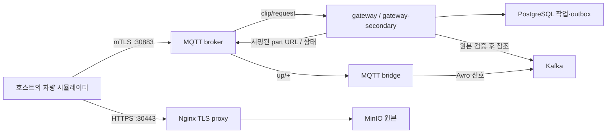

# 로컬 Kubernetes MQTT·원본 업로드

`clips-local`은 FleetSentinel 전용 kind 클러스터에서 MQTT 수집과 원본 업로드를 실행하는 구성이다.
현재 사용 중인 kubectl context를 읽어 배포 대상으로 삼지 않는다. 별도 kubeconfig와 명시적
`kind-fleetsentinel` context만 사용한다. 기존 Docker Compose 서비스와 GKE context는 유지한다.



## 준비 및 실행

Docker, kubectl, kind, Java 21, OpenSSL이 필요하다. kind 노드 이미지는
`kindest/node:v1.37.0`으로 고정했다. Docker에 이미지와 PVC 데이터를 저장할 디스크 공간을 확보한다.

```sh
bash scripts/k8s-local.sh
```

kind가 PATH에 없으면 `KIND_BIN=/path/to/kind bash scripts/k8s-local.sh`로 지정한다.
스크립트는 kind 생성, 개발 인증서 생성, 게이트웨이·bridge 이미지 빌드/적재, Secret 주입,
리소스 적용 및 초기화 Job 완료 확인까지 수행한다. 재실행 시 기존 인증서·PVC를 재사용하고
브로커·게이트웨이·bridge·TLS proxy 프로세스를 재시작한다. 최초 이미지 다운로드는 인터넷이 필요하다.

| 접점 | 로컬 주소 | 인증 방식 |
|---|---|---|
| 차량 MQTT | `localhost:30883` | 개발 CA와 차량 인증서로 mTLS |
| 원본 업로드 | `https://localhost:30443` | 서버 인증서 검증 + 만료되는 S3 part 서명 |
| 서버 → 브로커 | `ssl://mqtt:8883` | 서버별 MQTT 인증서 |
| 서버 → MinIO | `http://minio:9000` | 클러스터 내부 S3 API, Secret 자격증명 |

`localhost`는 kind와 같은 호스트에서 실행하는 차량 시뮬레이터용이다. 물리 차량이나 다른 컴퓨터를
연결할 때는 차량이 도달 가능한 DNS/IP, 해당 SAN을 가진 인증서, 외부 포트 공개 범위,
`OBJECT_STORE_PRESIGN_ENDPOINT`를 함께 변경해야 한다. 현재 kind 포트는 `127.0.0.1`에만 바인딩한다.
서명 URL의 host·query·path는 Nginx가 변경하지 않는다. 원본을 MQTT payload에 넣지 않는다.

## 인증서와 복제본

브로커의 `use_username_as_clientid true` 때문에 인증서 CN이 MQTT 세션 ID다.
`gateway`와 `gateway-secondary`는 각각 `clip-service`, `clip-service-2` 인증서를 사용하며,
상대 서버의 MQTT 개인키를 마운트하지 않는다. 각 Deployment는 1개 replica와 `Recreate` 전략이다.
하나의 Deployment를 `replicas: 2`로 늘리면 같은 CN이 충돌한다. 확장에는 별도 신원·ACL·Secret이 필요하다.

| Secret | 용도 |
|---|---|
| `mqtt-server-pki` | MQTT 서버 인증서·키, 클라이언트 신뢰 CA |
| `clip-service-pki`, `clip-service-2-pki` | 각 게이트웨이의 MQTT 클라이언트 신원 |
| `mqtt-bridge-pki` | 수집 bridge 신원 |
| `gateway-pki` | 기존 gRPC와 HTTPS 서버 mTLS |
| `object-server-pki` | 원본 업로드 TLS proxy |

CA 개인키와 차량 개인키는 Kubernetes에 올리지 않는다. 개발 PKI와 kubeconfig는
Git에서 제외한 `mqtt-local/k8s/`에 둔다. MQTT leaf 인증서는 7일 유효하다.
만료 시 새 MQTT PKI를 별도 디렉터리에 생성하고 서버·차량의 신뢰 CA와 인증서를 함께 갱신한 뒤 재시작한다.
이 로컬 구성은 운영 인증서 자동 갱신이나 HA를 제공하지 않는다.

## 구성 범위

`clips-local`은 Kafka 1대·RF=1·ISR=1을 사용한다. 이 overlay는 ClickHouse·Flink를 실행하지 않는다.
전체 `base`/`local` 구성의 Flink JAR 배포와 ClickHouse 초기화는 별도 기존 작업이다.
`COMPLETED`가 ClickHouse 카탈로그 반영 완료를 뜻하지 않는 계약도 그대로 유지된다.

## 상태와 종료

```sh
kubectl --kubeconfig mqtt-local/k8s/kubeconfig --context kind-fleetsentinel \
  -n fleetsentinel get pods,svc,pvc
kubectl --kubeconfig mqtt-local/k8s/kubeconfig --context kind-fleetsentinel \
  -n fleetsentinel logs deployment/gateway
# 전용 kind 클러스터와 그 안의 PVC 데이터를 삭제한다. 호스트의 PKI는 유지한다.
kind delete cluster --name fleetsentinel --kubeconfig mqtt-local/k8s/kubeconfig
```

기존 `Deployment/gateway`의 `app: gateway`만 있는 selector는 새로운 `instance` selector로
직접 변경할 수 없다. 이 가이드는 새 전용 클러스터를 사용한다. 이미 배포한 환경을 이전할 때는
업로드 작업을 보존한 채 기존 gateway를 교체하는 별도 절차가 필요하다.

구성 근거: [kind 포트 매핑](https://kind.sigs.k8s.io/docs/user/configuration/#extra-port-mappings),
[Kubernetes Deployment 전략](https://kubernetes.io/docs/concepts/workloads/controllers/deployment/#strategy),
[Kubernetes Service](https://kubernetes.io/docs/concepts/services-networking/service/).
